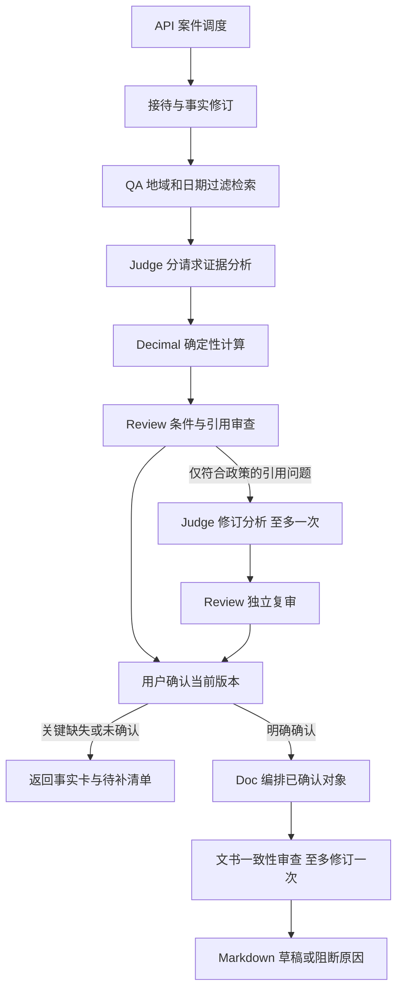

# 架构（2026-10-26）

FastAPI + LangGraph + 原 Web 单页；沿用 QA/Judge/Doc/Risk 模块。默认入口是自然咨询，明确办案意图后进入案件路径；案件使用统一受控图，不受旧 force_mode 绕过。普通咨询与案件共享同一 `ConversationStateStore`，QA 不再维护独立 checkpointer 记忆。

## 自然咨询路径（v16）

`conversation.py` 判定寒暄、概念、追问及明确案件操作，不修改案件。QA 先按地域和日期过滤法源，再以受限 JSON 接收模型解释；来源编号、法名条号、时效和部分危险证据判断经过后端校验，最多纠正一次。精确法条查询、寒暄和缺少指代的澄清无需模型；失败不改现有案件。

普通会话保存最近六轮完整回答并受 12000 字符预算约束；旧摘要显式标注。独立新问题不携带无关个案数值。案件快照只供材料解释读取，明确且唯一的工资期间修订才通过原工作流失效与重算。

前端按 `presentation.kind` 展示聊天气泡或案件卡；来源、完整事实、协同过程和审查记录可展开，旧案件卡折叠并停止操作。案件工作区保留最新状态，解释性追问回到聊天展示。

## 自然咨询路径（v16）

统一入口以自然对话开始；conversation.py 判定寒暄、概念、追问及明确案件操作，不由模型直接修改事实。QA 使用同一 ConversationStateStore 的六轮完整对话和12000字符预算，取消私有 checkpointer/CaseProfile 记忆。独立新问题不携带旧案数值；旧摘要显式标注。案件快照仅供解释读取，明确唯一期间的工资修订才通过原工作流校验、失效和计算。

法源先按地域日期过滤；核心咨询主题精确定位已有条款，不新增法源。模型返回自然正文与来源编号，后端校验存在性、法名条号及部分危险判断，最多纠正一次。校验不证明全部法律含义正确。精确条文查询、寒暄和缺指代澄清无需模型；失败不改现有案件。

前端按 presentation.kind 展示聊天气泡或案件卡；来源、完整事实、协同过程和审查记录可展开，旧案件卡折叠并禁用操作。案件工作区保留最新状态，解释性追问回到聊天展示。

## 状态与并发

`ConversationStateStore.case_transaction` 以 session_id 隔离，RLock 内比较 expected_case_version、执行、原子写入 JSON。案件具有独立事实、来源、请求、计算对象、法源、审查、确认快照、文书、阶段与失败记录。旧会话标签只进入 `historical_information`，状态为 unverified_legacy，不能自动成为确认事实。

事实/日期/地区/知识 digest、计算规则或工作流版本变化递增案件版本，清空下游有效产物；依赖记录在 dependencies，过期确认返回 409。模型不能自行修改事实或计算金额。文书模型编排的请求、金额、依据和证据必须严格等于当前确认对象，然后用固定结构渲染。审查两次仍失败则阻断。

事务锁覆盖整个案件流程，适用于单进程演示；不能据此宣称多进程并发安全。损坏 JSON 保留原文件，返回明确错误，不静默清空。

普通分析与案件接待共用保守的材料陈述提取器；仅提及、询问、假设或单位持有不自动记为用户持有。材料逐项合并及保存来源，事实矛盾独立持久化在 fact_conflicts，不能通过“继续分析”或重载清除。明确修正对应字段后再重新分析与确认。当前工作流依赖版本为 casework-20261026-v16，升级会使旧确认失效。角色读取范围、结构化输出与审查边界见[上下文契约](ROLE_CONTEXT_CONTRACT.md)。

## 角色与模型

QA 返回满足地域/时间的条款、案例和指引。Judge 仅补充逐请求的证据条件、不利因素及追问。确定性计算拥有法律条件分支、金额与参数依赖。Risk 的相关检查进入 Review，Review 只能增加有依据的发现，不能删除规则阻断。Doc 只编排已确认对象，不从文本重提取金额。

解除条件由 conditions.py 按情形列出，具体条件与用户主张分开。Judge能看到案例事实、处理要点与适用限制；Review只接收原始陈述、工具和法条，不读取案例裁判结论及Judge论点。深圳优先采用普通仲裁裁决，保留支持与不支持方向，刑事欠薪报道不能替代普通欠薪的成立分析。法条按解除等相关事实日期筛选，案例按争议准备日期判断是否已公开，两种日期含义分开。

Judge和Doc使用Qwen-plus；Review可独立配置Qwen3.8-Max。temperature 0.1、超时及有界重试，记录实际模型、finish_reason、usage、耗时和失败；未启用时显式进入rules_only。它是受控角色协同流程；真实模型效果必须单独实测，不能凭节点数量证明优于单Agent。

v13将not_selected请求保留在案件与页面，但从模型待分析集合排除；Judge输出Schema明确请求编号、条数和可用引用，遗漏纠正会列出具体编号。无待分析请求时不调用Judge/Review，仍保留确定性规则的关键问题；因此足额支付可得到no_supported_claim，不会因模型再次检查已排除请求变成待专业复核。请求和金额确认条件未放宽。

v14在没有其他关键阻断时，将有原文锚点、涉及Judge既有引用的citation关键问题交回Judge修订一次，再独立复审。修订节点禁止改变事实、条件、金额、确认及文书；越权修改恢复后停止。复审未解决则阻断，历史初审及修订后复审分别留存并可在前端展开；不把删除或降低问题等级当成修订完成。

v15用字段路径反馈结构错误，保留必填校验和一次纠正上限；不自动补齐模型漏项。独立观察模块统一记录Judge及Review/Doc的返回与SDK截断异常；异常带回的实际用量不会丢失，缺失的值仍为未知，length不计成功。新实测报告的源码清单包含所有办案模块，覆盖新增观察模块与引用修订模块；历史报告不回写。

## 法源与参数

manifest → 哈希/条数验收 → 独立候选索引 → 原子 active 指针。旧索引保留 previous 回退；构建入口已统一，旧 Chroma 不用于现行答案。

检索顺序为地域/日期过滤、精确法名条号、词项排序，可选向量融合。历史版本、部分废止和适用冲突单独标记，不机械用地方规则覆盖全国规则。最低工资和第四十七条封顶数据分用途，缺参保留公式。当前封顶参数 pending，不能产出 N/2N 确认草稿。

## 前端与接口

原 `/api/chat`、`/api/chat/stream` 响应字段保留，`structured.workflow=case` 激活案件卡。进度事件来自节点开始/完成；页面展示事实修订、覆盖等级、缺失项、请求和金额、法源原文、修订记录及确认按钮。旧文书复制会核对最新版本，失效草稿不能继续复制为现行结果。

详见 [API](API.md)、[交付说明与限制](GBA_CASEWORK_IMPLEMENTATION.md)。

## v17前端展示（2026-10-27）

公共API与案件模型未改变。前端根据structured.presentation与workflow区分对话和案件，法源按回答绑定，详情面板和未保存编辑只写浏览器UI状态，不写后端事实。请求开始时固定session_id，响应仅更新原会话。事实保存后再走已有分析/失效/确认，409停止确认并由用户显式同步；不自动重试确认。桌面三栏、平板抽屉和手机全屏共用同一状态。Markdown库本地加载，缺失时转义为纯文本。
