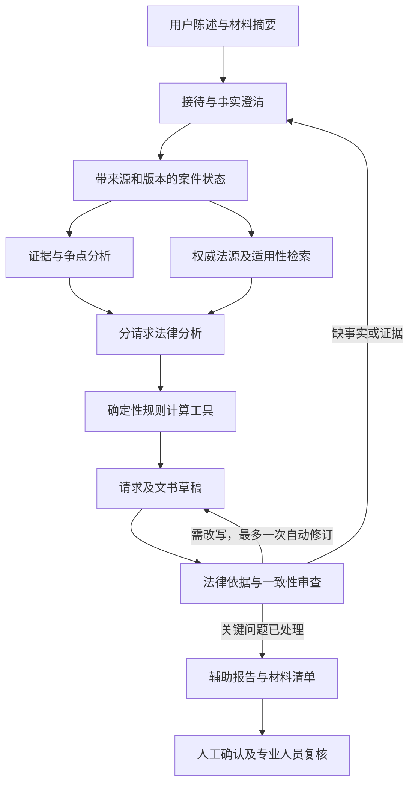

# 劳法智枢项目复评与挑战杯提升方案

评估日期：2026-10-25，Asia/Shanghai。目标：挑战杯“大挑”科技创新方向，按团队给出的 2026-11-03 材料截止时间倒排。

**判断：现有项目已经具备可运行的劳动争议辅助原型，有值得保留的确定性计算和会话共享基础；但“多智能体协同提高法律可靠性”的核心主张尚缺少完整机制和实验支撑。优先把一个劳动争议场景做深，并用法源、案件状态、审查记录和对照实验证明价值。**

本轮核查了代码、现有测试、历史评测、原始知识文档和当前本地 Chroma 数据库，并进行了网上调研。仓库代码基线：`d31d76499a228700ec99afa80e084b034d87ac3c`。本轮没有修改业务实现。

本地执行 `.\venv\Scripts\python.exe -m unittest discover`，结果为 **18 tests，OK**。其中会话与工作流测试使用 mock Agent；该结果证明受测工程行为，不代表在线模型法律正确率。本轮没有重新调用在线 LLM/Embedding 评测，没有进行真实用户试点或法律专家评审。

可复核的本地探针结果保存在 [evidence.json](evaluation/reassessment_20261025/evidence.json)。下文明确区分现状、建议和待验证主张。

## 第一重审视：定义关键问题与领域

当前目标应定义为：证明系统在劳动争议材料准备中，能比通用聊天或单次 RAG 更可靠地处理不完整事实、计算条件、法律引用和文书一致性。

这涉及软件工程、法律方法、法律 AI 评测和竞赛成果表达四个领域。用户最需要的交付物不是一段长法律回答，而是“哪些事实还缺、哪些请求有依据、金额如何算、证据如何准备、材料如何形成”。

建议首期主用户明确为劳动者及帮助劳动者整理材料的法律援助人员。企业用工合规可以作为后续独立工作流；当前 RiskAgent 同时输出企业整改与劳动者应对，容易使项目主线分散。

网上检索到的第十九届挑战杯官方通知强调科技发明制作的应用价值与转化前景。当前没有取得本校本轮申报通知、评分表和模板，因此不套用网上旧版分数比例，也不把上一届要求视为本轮完整细则。[挑战杯第十九届官方通知](https://2025.tiaozhanbei.net/d49/article/676/)

**这一重审视改变了什么：评估单位由“有多少功能模块”转为“一件劳动争议能否形成有依据、可复核的辅助材料”；9 天内的投入优先级随之收敛。**

## 第二重审视：领域大师理论体系与判断主轴

采用三个成熟判断框架，而不以框架名称或模型大小作为先进性的替代证据。

1. **职责分离与受控工作流。** 事实抽取、法源检索、规则计算、主张分析、审查和文书生成需要不同输入输出约束。Anthropic 的工程指南建议从简单可验证的方案开始，区分 routing、编排与评估修订；LangChain 文档也区分 Router、Subagents 和 Handoffs。对本项目的启示是保留简单问题的快路径，只对复合案件启用协同。[Anthropic 指南](https://www.anthropic.com/research/building-effective-agents)、[LangChain 多智能体文档](https://docs.langchain.com/oss/python/langchain/multi-agent)
2. **法律三段论与请求权基础分析。** 先确定规范及其构成要件，再判断事实和证据能否满足要件，最后形成请求。金额公式不能先于解除性质认定。对每个请求建立“事实—证据—规则—结论—例外”的对应关系。
3. **对照实验与消融。** 系统能回答不等于多智能体有效；必须控制模型、法源、工具和预算，观察协同是否减少引用错误、金额错配或事实遗漏。LawBench 将法律能力分为记忆、理解和应用，可借鉴其任务分层，另建劳动争议业务测试集。[LawBench 原论文](https://arxiv.org/abs/2309.16289)

主要矛盾是：界面和输出看起来完整，但法律结论的成立条件、来源和纠错机制还不完整。前端美化、更多 Agent 名称和更多争议种类是次要问题。

**这一重审视改变了什么：架构评价标准转为输入输出约束、真实依赖和纠错效果；专业性评价标准转为法律适用链；创新性评价标准转为可复现实验。**

## 第三重审视：关键事实与综合理论体系

### 1. 当前基础哪些合理

| 现有设计 | 评价与应保留的价值 | 当前边界 |
|---|---|---|
| 劳动争议垂直范围 | 能围绕工资、工龄、解除和证据形成共同案件状态 | 当前功能口径仍过宽，工伤、社保、税额等均有额外条件 |
| 确定性计算工具 | 核心算术交给代码，适合审计和回归 | 输入的法律类型目前可能被关键词误判 |
| `session_id` + JSON 状态 | 单机、单进程演示足够轻量；已具备跨轮事实和计算复用 | 不是完整案件档案，也不是多用户访问隔离机制 |
| 普通问答与前案上下文隔离 | 避免法条问答被旧金额污染，工程判断正确 | 缺少事实来源、冲突状态及跨模块产物版本 |
| 法条与案例分库、条号重排代码 | 检索方向合理 | 当前持久化库的内容和 metadata 与代码能力不匹配 |
| FastAPI + 单页前端 | 足以承载本轮参赛原型 | 多 Agent 运行状态、真实阶段事件和失败降级尚不完整 |

不建议在提交前更换技术栈、重构微服务或自行训练底座模型。先修正知识和判断，再补协同机制。

### 2. 多智能体现状：有分工与跨轮共享，协同闭环不足

代码证据：

- `agents/router_agent.py:145` 的 `plan()` 只返回一个 route；`:158` 的主 `route()` 是关键词匹配和默认 qa，`route_with_llm()` 未成为默认调度链。
- `api/server.py:241` 的 `_run_agent()` 每次选择一个子模块；`:676` 的请求流程负责会话读取、事实合并、计算、路由、执行和持久化。
- `QAAgent` 的常规路径是检索后直接生成，ReAct 工具循环为异常后的 fallback；不能把所有请求描述为自主 ReAct 协作。
- `JudgeAgent`、`RiskAgent`、`DocAgent` 的 `run()` 没有统一检索法条与案例；主要依赖模型生成、注入文本和局部规则。
- 没有明确的任务依赖图、跨 Agent 产物协议、独立法律审查和驳回修订回路。

因此，当前最准确的描述是“**基于路由分工与会话共享的多模块法律辅助原型**”。可以说明已有多智能体协作基础，但尚不能证明复杂案件经过了多角色联合核验。

### 3. 法源覆盖与溯源：是当前优先级最高的短板之一

本轮以只读 SQLite 方式核查当前 `chroma_db/chroma.sqlite3`：

- `labor_law` 为 **117 个库内片段**，`labor_cases` 为 **2 个库内片段**。片段数不是法规数或案件数。
- metadata 表仅有 `chroma:document`，未发现 law_name、article、来源 URL、效力日期等自定义字段。代码中定义过 metadata 不等于现有库已带有这些字段。
- 法律库中的“第四十七条”实际是《劳动法》关于工资分配方式和工资水平的规定，不能据此支持《劳动合同法》第四十七条经济补偿计算。
- 法律库中的“第八十二条”包含六十日仲裁申请期限的旧文本，缺少与后续特别法的适用关系治理。当前一般劳动争议仲裁时效应依《劳动争议调解仲裁法》第二十七条分析，且该条还规定中断、中止和拖欠劳动报酬的特别情形。[人社部中国就业网法条全文](https://chinajob.mohrss.gov.cn/h5/c/2022-07-15/356212.shtml)
- 原始 `劳动法.docx` 是《劳动法》全文，不能等同于劳动争议完整法源库；备用 `labor_contract_law.txt` 是节选摘要。当前库里出现《劳动合同法》名称主要来自案例叙述，不能证明已收录其完整规范。
- 当前库内未发现劳动争议司法解释（二）等关键规范；最高法发布的 2025 年解释自 2025-09-01 施行，涉及竞业限制、混同用工、社保等问题。[最高法发布说明](https://www.court.gov.cn/fabu/xiangqing/472691.html)

备用 `data/case/cases.txt` 首条将“指导案例12号”写成加班费案例。最高法官方目录对应的是“李飞故意杀人案”。这是应纠正的法源标注问题。本轮当前向量库没有检出这条编号，因此不能说当前在线检索已经引用了该错误；风险在备用数据及未来重建过程。[最高法指导案例目录](https://www.court.gov.cn/shenpan/gengduo/77_15.html)

建议优先整理：完整《劳动合同法》及实施条例、《劳动争议调解仲裁法》、现行劳动争议司法解释（一）（二），再按演示场景补充工资、工时、年休假和一个地区的适用标准。每条保存官方 URL、发布机关、文号、条款、效力范围、施行及失效日期、核验时间；摘要单列，不冒充原文。

案例至少按单个案件组织，保留官方出处或公开案号、裁判/发布日期、地域、关键事实、争点、裁判要旨、支持与不支持条件。已匿名的官方典型案例可以没有公开案号，但必须保留可核查发布出处。教学示例须单独标识，不当成真实裁判。

### 4. 确定性计算：算术可控，定性前提尚不可靠

本轮直接调用当前函数得到：

| 本地探针输入（均为月薪 10000、工龄 3 年） | 当前行为 | 问题 |
|---|---|---|
| “公司合法解除，但目前没有补偿” | 归为非法辞退，计算 60000 元 | “没有补偿”不能直接推出违法解除 |
| “公司说我严重违纪，突然辞退我” | 归为非法辞退，计算 60000 元 | 解除理由、证据及程序仍待审查 |
| “依据第四十一条经济性裁员，未提前通知” | 归为 N+1，计算 40000 元 | 第四十一条裁员程序不能简化为第四十条代通知金 |
| “我不是被违法辞退，公司和我协商解除” | 仍归为非法辞退，计算 60000 元 | 否定词未正确作用于事实和法律类型 |

这些探针证明了具体解析缺陷，不构成对所有案件或在线回答准确率的估计。《劳动合同法》第三十九、四十、四十一、四十六、四十七、四十八和八十七条需要联合适用，协商解除还需区分提出方等条件。[劳动合同法官方全文](https://www.samr.gov.cn/zw/zfxxgk/fdzdgknr/bgt/art/2023/art_0abfdd261c03417b949df19d869add8d.html)

应将“用户称公司违法”保存为陈述，不直接保存为已认定法律事实。法律类型未确定时，先追问解除依据、提出方、通知和证据；必要时输出条件情景及对应金额。计算结果应包含输入、工资基数期间、规则版本、前提、缺失条件及 `calculation_id`。文书消费该对象，不再从拼接文本重新解析金额。

### 5. 证据与风险面板：有展示，尚缺可靠评估依据

输入“没有劳动合同、没有工资流水、没有考勤记录、没有聊天记录、没有辞退通知”，当前五类证据均会被标记为“已提及”，并赋予 78 的 strength；面板完整度会按提及数统计。虽然界面用词不是“已核验”，但否定陈述被当成积极线索，仍会误导证据准备判断。

`_infer_risk()` 的 82、64、62 等数字为固定启发式值；“公司没有违法解除”也可触发高风险 82。不能将它们称为经过统计验证的法律风险评分。

应将证据状态分为：尚未提供、用户称持有、已上传待核验、已核验摘要、缺失/否认、存在争议。当前上传按钮仍禁用，短期可以先用人工填写的材料清单和摘要，不宣称具备证据真伪鉴定能力。证据数量更不等于证明力。

### 6. 案件预判与文书：减少无依据的确定性

`JudgeAgent` 提示要求“胜诉概率百分比区间”，目前没有与之配套的已标注结果数据和概率校准。宜改成“分请求成立条件、支持因素、不利因素、证据缺口和适用不确定性”。其“劳动仲裁庭法官”角色设定也应改成案件分析助手，避免混淆法院法官、仲裁员与系统身份。

文书的专业性应通过请求—金额—事实—证据—依据一致性体现。不能将 N、2N、代通知金作为默认可全部叠加项目；涉及互斥或备选请求须明确。缺失的主体、地址、日期保留占位，并生成待补材料表。模型审查通过也不等同于律师已审核或材料可直接提交。

### 7. 评测资料：历史输出需要保留，结论口径需要重做

旧报告记录的是 2026-06-06 的 236 条用例，不能当作 2026-10-25 的当前成绩。其问答“100%”等结果主要依据词项覆盖，不是专家法律审查。

具体反例：旧 QA-05 输出“试用期被辞退且无任何理由，通常不能主张赔偿”，仍被标记 PASS，score 为 0.38。当前脚本的问答通过条件是 `ratio >= 0.35 or hits >= 3`；命中几个词并不能证明结论正确。旧用例的参考答案本身也需复审，例如经济性裁员和代通知金、不同请求的时效不能简单类推。

名为“对比实验”的 `run_comparison()` 主要对当前系统运行不同题型，未建立明确的通用模型、单 Agent 或去掉协同的对照组，不能据此得出“多智能体优于单智能体”。

### 8. 网上相关工作的直接启示

| 资料 | 查到的内容 | 对本项目的影响 |
|---|---|---|
| [ChatLaw，当前论文版本](https://arxiv.org/abs/2306.16092v3) | 已将律师事务所 SOP 与多角色协作作为法律助手设计 | “法律 + 多 Agent”并非新的研究方向，不应宣称首次提出 |
| [LawLuo](https://arxiv.org/abs/2407.16252v3) | 多轮法律咨询中设置接待、律师、记录和评价角色 | 最值得借鉴的是记录、澄清与评价，而非增加角色数量 |
| [LabourLawBench，2026 预印本](https://arxiv.org/abs/2601.09972) | 覆盖劳动法引用、问答、分类、计算、实体和案件分析等任务 | 可借鉴任务设计；不能把论文分数当作本项目结果，数据可得性及使用条件另行核验 |
| [AlphaGPT 厂商官网](https://www.icourt.cc/product/alphaGPT) | 已宣传咨询、起草、类案检索和案情分析等能力 | 通用功能组合不足以体现差异；这里是产品方陈述，未进行独立产品效果测试 |

综合解释模型是：**可靠结果 = 可确认的案件事实 × 适用法源 × 正确业务规则 × 可审查的协作过程。** 任一环节缺失，增加生成能力都可能放大错误。这个表达是本次评估的设计模型，不是统计公式。

**这一重审视改变了什么：优先问题由“协同展示不足”上调为“法源覆盖和定性规则存在具体缺口”；升级顺序应为法源与条件判断、共享产物、审查闭环，最后才是展示。**

## 第四重审视：反方压力与结论前提辩证分析

最强反方是：单个足够强的模型，拿到同样的法源、规则和清晰提示，也可能完成这些任务；多 Agent 会增加调用、等待和错误传播。如果多个角色使用同一模型、同一不足的知识库，复核也可能共同犯错。

这一反方成立，因此不能预先假定多智能体一定更准确。应同时比较以下方案：

| 方案 | 适用情况 | 应如何决策 |
|---|---|---|
| 单 Agent + 检索 + 规则工具 | 简单问答、单项计算、输入充分的短任务 | 作为保留的快路径，也是强基线 |
| 有界案件工作流 + 专业角色 + 独立审查 | 复合请求、多轮修正、材料和金额联动 | 本轮主推，但必须证明减少了具体错误 |
| 多角色自由讨论或全自动模拟法庭 | 更开放的研究与探索 | 9 天内收益不确定，且缺少事实核查时容易增加表演性 |

关键前提及处理：

- **共享记忆有效**：18 项回归提供局部工程证据；升级为事实来源和版本管理后仍需新验证。
- **专业审查有效**：目前只是待实现假设；必须记录审查发现、修订前后结果和误拦截，不能把审查节点亮灯当成完成。
- **用户有真实需求**：项目选题具有合理性，但仓库未提供本轮验证过的真实访谈和试点结果；需要补充小样本使用任务和反馈，不估算不存在的推广人数。
- **校赛接受当前作品分类**：以用户给出的科技创新方向为前提，具体作品类别、材料与证明要求仍以本校通知为准。

**这一重审视改变了什么：多智能体从预设优势降级为待验证技术选择；同时保留单 Agent 路径，并把同资源强基线和失败转向条件纳入计划。**

## 第五重审视：全貌理解与可验证收束

### 1. 推荐架构：一份案件档案，多角色产物，有限复核

建议将完整案件模式编排成以下流程。图中“规则工具”不是必须包装成 Agent；节点名称不代表当前已经实现。

9 天内的最小改动可以复用现有模块：Router 承担显式工作流调度；QA 的检索抽成共享服务；Judge 改为分请求分析；Doc 使用结构化结果；新增轻量 Review，并把 Risk 的适用性检查纳入审查规则。先完成违法解除/经济补偿场景，其他复杂功能保留为原型能力或后续规划。

每个角色的产物至少包含 `case_id`、`state_version`、使用的事实 ID、法源 ID、结论、缺失条件、冲突及任务状态。建议实体有：

- `Fact`：陈述内容、陈述方、来源轮次/材料、确认状态；用户修正后保留变更记录。
- `Evidence`：材料名称、用户持有状态、证明目的、覆盖事实和缺口。
- `LegalSource`：法名、条款、版本、效力、官方链接及适用地区。
- `Claim`：请求、构成要件、有利/不利事实、互斥/备选关系。
- `CalculationResult`：输入、基数期间、公式、假设、金额、规则版本。
- `ReviewIssue`：问题类型、被审查结论、依据、修订动作、是否解决。

调度节点只有在上游条件满足时才能继续；事实改变后须使依赖的结论和金额失效并重算。审查最多一次自动修订，仍有关键缺口则返回待确认项，避免无限循环。规则核验优先检查来源存在、金额对象一致、请求互斥与字段缺失；模型负责语义审查，不能靠自我赞同证明事实正确。

### 2. 怎样让评委看到协同

前端展示真实任务事件及其产物摘要，例如“已识别缺失解除原因”“已找到现行法条”“金额按条件分别计算”“审查发现请求重复”“文书已按修正结果更新”。每个事件应来自后端真实阶段，点击能查看来源和修订差异。

当前 SSE 在 `_build_chat_payload()` 完成后才分块发送答案，没有反映真实节点执行过程。应区分真实阶段进度与最终文本流，先解决阶段事件；本轮未测得当前在线首字延迟，不使用旧记录宣称当前响应速度。

一个适合演示的脚本：用户称月均工资 8000、在职 3 年 2 个月，公司以不能胜任为由解除，未提前通知。系统先追问是否培训或调岗、解除通知及工资基数。仅在明确条件下列示 N、第四十条相关代通知金或违法解除赔偿等备选结果；工资基数相同只是演示假设，真实计算区分适用工资口径。用户补充“已经培训调岗且仍不能胜任”后，系统展示结论和金额的更新，文书同步变化。另一条“我没有考勤”必须进入缺失证据状态。

演示样例不进入最终盲测集。不要安排无事实依据的角色争辩，也不展示模型私有思维链；展示输入输出、引用、工具结果及审核记录即可。

### 3. 法律专业性如何形成可展示产物

每个请求输出一张对应表：请求及条件、用户已确认事实、对方可能抗辩、支持证据、缺失证据、适用规则、条件化结论、金额和下一步。专业性具体表现为：

- 能区分劳动关系成立与否、解除性质、解除提出方和程序，不只识别几个争议关键词。
- 能区分《劳动法》与《劳动合同法》同一条号，区分现行条文、历史文本和案例参考。
- 能处理 N、2N、代通知金的适用及互斥/备选，不把所有权益简单相加。
- 能按不同请求分析时效、起算点、可能中断和特别情形；不能只在所有回答结尾附一句“一年”。
- 能解释证据的证明目的和可能抗辩，而非仅数文件或给无依据分数。
- 能在材料不足时追问或保留条件，文书金额、主体、时间线与已确认案件档案一致。

### 4. 最小可信评测

建议冻结 **60 个案件/任务单位**：20 个规则清晰的标准场景、20 个多轮补充/修正场景、10 个缺证据或信息不足场景、10 个否定表达及规则易混淆场景。按案件统计完成率，多轮消息不能重复计作多个独立案件。测试集应与开发调参、演示案例隔离，并由劳动法教师或律师复审参考答案；尚未获得复审时如实说明。

分两阶段比较，避免把不同提升混为一谈：

1. 纯模型 → 同模型 RAG → 同模型 RAG + 规则工具，用于测知识与工具增益。
2. **单 Agent（同法源、同工具、同结构化案件输入） → 分工工作流 → 分工工作流 + 审查**，用于测协同和审查的增益。

主实验统一底座模型和版本、检索资料、输出要求、采样设置及预算；如当前快慢模型策略另作部署实验，不将模型差异归因于协同。报告调用次数、token、实际成本与延迟。可在较小子集重复 3 次观察波动，保存逐案结果，避免只公布一个平均分。

| 指标 | 可操作定义 |
|---|---|
| 法源真实性与有效性 | 引用的法条是否存在、版本与案情时间是否适用 |
| 法律适用正确性 | 引用内容是否支持该请求，是否遗漏关键条件和例外 |
| 金额正确性 | 前提正确后，基数、期间、公式与金额是否匹配；不能只比末尾数字 |
| 多轮事实一致性 | 修正事实被正确更新，旧金额和旧文书能否相应失效 |
| 缺失信息处理 | 应追问/保留条件时是否避免无依据定论 |
| 请求与文书一致性 | 请求、金额、事实、证据目录、主体及日期是否一致 |
| 严重错误率 | 错误时效、错误法源、互斥请求重复金额等单独统计，不被格式分抵消 |
| 审查有效性 | 对独立确认的真实错误，有多少被发现并修正；同时统计误报和引入新错误 |
| 效率 | 端到端 P50/P95、调用数、token/费用；小样本时说明统计限制 |

不要直接采用“关键词超过 35% 就通过”。自动检查适合金额、字段、引用存在性；法律适用和证明关系需要明确评分细则与人工复核。报告输出实际正确数/样本数、边界和失败案例。

可另做 5—10 人的小规模材料准备任务，记录完成时间、遗漏项、帮助程度和使用前后差异；这是形成性用户验证，不外推社会总体，也不等同真实仲裁成效。

### 5. 2026-11-03 前的执行顺序

以下是建议安排，不代表已经完成的功能或结果。

| 日期 | 重点 | 交付及验收 |
|---|---|---|
| 10/25—10/26 | 核对校赛模板；冻结违法解除/经济补偿主场景；纠正法源及评测口径 | 权威法源清单、数据版本；否定词/法律条件错误进入问题单 |
| 10/27—10/28 | 复用已有 Agent 实现案件工作流、结构化产物与一次审查修订 | 同一案件能完成澄清、分析、计算、草稿、审查；未知条件能阻止定论 |
| 10/29 | 文书一致性和真实阶段事件 | 金额、请求、证据清单一致；修正事实后相关产物更新 |
| 10/30—10/31 | 冻结测试集并运行强基线/消融；安排有限专家与用户验证 | 逐案结果、严重错误、成本延迟和修正案例；没有取得的评审不填已完成 |
| 11/01—11/02 | 整理申报书、技术报告和演示；冻结版本 | 架构图、创新点—机制—实测证据表、局限及贡献说明 |
| 11/03 截止前 | 按学校要求完成提交材料 | 复核附件、格式及版本；本轮未代替团队向外提交 |

P0 是法源、法律定性、否定词、无依据分数和评测可信度；P1 是有界协同、审查与文书一致性；P2 是 OCR、更多案由、多模型辩论、微调、复杂平台化和多租户部署。若时间缩短，保住 P0 和一个 P1 完整场景。

### 6. 参赛材料应该怎样写

当前可用题目：“劳法智枢——面向劳动争议的法律辅助系统”。核心升级完成且验证后，可用“劳法智枢——面向劳动争议的证据约束多智能体协同辅助系统”。

创新点用“问题—机制—证据”组织：

1. 针对多轮事实修正导致金额与文书不一致，提出带来源和依赖版本的案件状态；用多轮修正任务验证。
2. 针对生成模型法律定性和金额推导混淆，建立法源约束、条件判断与确定性计算的分工；用边界用例和强基线验证。
3. 针对跨模块结论互相矛盾，增加请求—法源—金额—文书一致性审查；用错误发现率、修正率和误报验证。

以上三点当前属于拟完善并验证的机制，不能直接在申请书中全部写成已完成成果。LangGraph、Chroma 和调用 Qwen 属于所用技术；团队自己的贡献是案件模型、领域规则、协作协议、检查机制与实测结果。使用开源和外部 API 的边界应说明。

推荐材料结构为：具体用户问题 → 现有方案与不足 → 本项目机制 → 实现与边界 → 对照实验 → 试用与社会价值 → 局限与后续。按本校模板映射，不预设必须交某种附件。社会效益以已有访谈、实际试用和任务结果支撑，不写未经核实的用户数、准确率或市场效果。

答辩中最需要准备的四个问题是：“多个角色比一个角色好在哪里？”“为什么这个法条适用？”“事实修改后谁保证金额和文书一起更新？”“系统不知道时会做什么？”每个答案都应能打开一个真实记录或结果。

**这一重审视改变了什么：方案从泛化的多智能体平台收敛成可在截止前实现和验证的单场景闭环；验收标准从界面完成转为引用可靠、条件正确、产物一致及协同增益可测。**

## 最终判断

项目方向合理，现有工程基础有用；当前法律专业性和协同创新证据不足，不能仅靠包装弥补。最值得争取的参赛亮点是：围绕一个劳动争议，把事实澄清、法源适用、规则计算、文书准备和纠错做成可复核系统。

如果协同实验没有优于同资源的单 Agent，就保留更简单的主路径，将创新点收敛到领域规则、事实一致性和法源治理。若能展示一个真实发现并修正法律错误的协作过程，加上一组公平对照结果，项目将比“多种功能集合”的表述更有说服力。是否达到具体奖项水平仍取决于完成结果、校赛细则和同组竞争，当前证据不足以预测。
