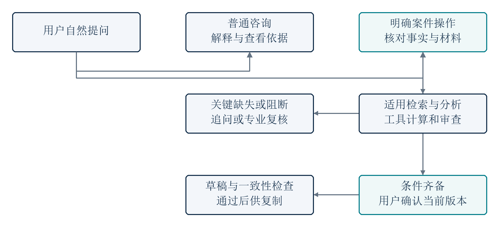
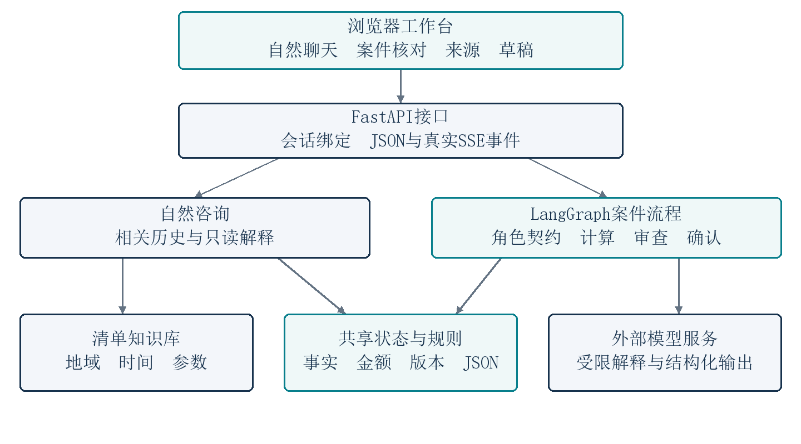
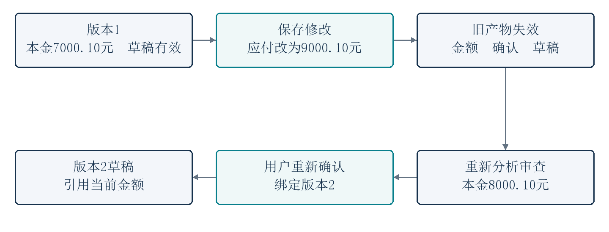
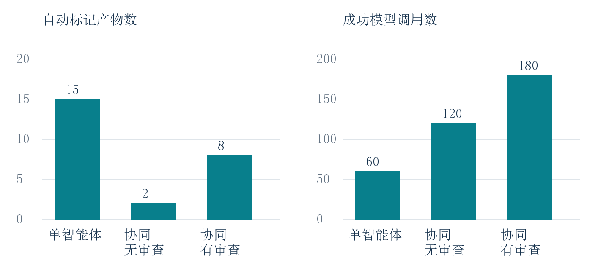

# 劳法智枢大挑申报说明书

面向广深劳动争议维权准备的受控多智能体辅助系统

科技创新项目　第一版　2026年10月31日

项目团队：劳法智枢项目组

申报人、学院、指导教师及学校规定的项目类别：待按正式申报信息填写。

## 摘要

劳动争议咨询常面临事实表述混杂、法源适用复杂及计算与文书脱节等问题。本项目面向劳动者和法律援助人员，以广州、深圳为重点，构建全国基础法源、广东规则与城市资料相结合的知识库，采用共享案件状态驱动的受控多智能体流程，将事实核对、地域时间检索、请求分析、确定性计算、用户确认和文书审查衔接起来。系统已实现自然咨询及欠薪材料准备闭环，支持事实修改后旧金额、确认和草稿同步失效。既有146项Python回归与60案工程验证通过，并完成三组真实模型对照实验。当前成果为可运行工程原型，法律专家评分、独立盲测及真人可用性研究仍待完成。

关键词：劳动争议；多智能体协同；地域知识库；确定性计算；版本一致性

## Abstract

Labor dispute preparation requires consistent facts, applicable legal sources, reproducible calculations and coherent documents. This project develops a controlled multi-agent assistance system for workers and legal aid personnel, focusing on Guangzhou and Shenzhen. A shared case state connects fact clarification, jurisdiction and time filtering, claim analysis, deterministic calculation, user confirmation and document review. The prototype supports conversational consultation and a wage-arrears preparation workflow. Changes to facts invalidate dependent calculations, confirmations and drafts. Existing engineering records report 146 Python regression checks and 60 case tasks passing, together with a three-group experiment using actual model calls. These results establish selected engineering behaviors rather than legal accuracy. Expert assessment, independent blind testing and participant-based usability research remain pending.

Key words: Labor Disputes; Multi Agent Collaboration; Regional Knowledge Base; Deterministic Calculation; Version Consistency

## 目录

<!-- WORD_TOC -->

## 1 项目背景与问题提出

### 1.1 行业现状

劳动争议直接涉及劳动者的工资收入、就业稳定和基本生活保障。国家发展改革委《中国营商环境发展报告（2025）》披露，2024年全国各级劳动人事争议调解组织和仲裁机构共办理劳动人事争议案件425.7万件。[1]这一数字反映相关公共服务的业务规模，不等同于本项目的潜在付费用户数量，也不用于推算市场收入。

公共法律服务正在加强对劳动者权益的保障。司法部组织开展维护劳动者合法权益法律援助“安心行动”，提出加强追索劳动报酬诉求处理、指导收集整理证据等措施。[2]《中华人民共和国法律援助法》将符合条件的确认劳动关系、支付劳动报酬等事项纳入法律援助范围。[3]这些制度说明，劳动争议准备需要与既有法律援助、调解仲裁渠道衔接，技术工具应帮助当事人把问题和材料整理清楚。

法律人工智能产品已从单轮问答发展到检索、分析和文书工作流。通义法睿提供法律咨询、法规及案例检索、文本阅读和文书生成等能力；Harvey、CoCounsel等产品强调法律工作环境中的资料、流程和起草支持。[4-6]本项目据此选择劳动争议准备这一具体环节，研究模型能力如何在法律条件、金额和人工确认的约束下使用。

### 1.2 现存痛点

（1）普通表达难以直接转化为可处理案情。劳动者可能同时陈述“被突然辞退”“没有补偿”“没有考勤”，其中分别涉及事件、请求和材料缺失。若仅匹配关键词，容易把“没有补偿”推为违法解除，把“没有考勤”记为持有考勤材料。前一轮的错误定性还可能进入后续记忆，影响多轮分析。

（2）找到法条不等于选对依据。法规存在全国、省级和城市层级，城市规则还有历史版本。相同条号可能属于不同法律；最低工资与经济补偿封顶工资虽都表现为工资数值，用途并不相同。直接按文本相似度检索或机械采用“地方优先”，可能产生不适用来源和错误参数。

（3）计算、确认和文书容易脱节。工资期间、应付与实付金额在对话中会反复修改。若各模块保留不同记忆，或文书从生成文本中再次提取金额，会出现当前计算正确、旧文书仍被复制的问题。只在界面提醒用户重新核对，不能替代后端的失效控制。

（4）用户难以判断系统正在做什么。将所有回答排成固定报告，会增加普通咨询的阅读负担；一次展示大量字段，又会让首次准备材料的劳动者不知从何开始。与此同时，如果只显示“正在思考”，用户看不到缺失信息、阻断原因和必须本人确认的环节。

### 1.3 项目研究意义

本项目的研究意义在于把法律辅助任务转化为可检查的数据交接过程：识别哪些内容是用户陈述，确定哪些依据满足地域和时间条件，规定哪些金额必须由工具生成，并让确认只对当前版本有效。系统由此形成可追溯的准备材料，而非直接输出未经核对的最终判断。

对劳动者，预期价值是降低组织案情、核对金额和准备材料的操作负担；对法律援助人员，预期价值是提供结构清楚、缺口可见的初始材料；对技术研究，价值是观察职责分离与版本控制能否减少错误传播。这些实际服务效果仍需用户和法律专业人员研究，当前不宣称已经降低维权成本或提高仲裁成功率。

## 2 竞品分析

### 2.1 行业竞品梳理

本项目选取具有官方公开介绍的法律AI产品进行功能与定位对标。表1比较其主要服务方式及本项目可借鉴的设计。资料核验日期为2026年10月31日，未登录付费产品开展功能实测，不进行法律准确率或价格排名。[4-7]

表1 法律AI产品定位与本项目设计参照

| 产品 | 官方公开的主要能力 | 本项目借鉴与场景差异 |
| --- | --- | --- |
| 通义法睿 | 法律咨询、法规与案例检索、文本阅读、文书生成、合同审查 | 借鉴任务分工；本项目进一步约束劳动争议的金额与确认 |
| Harvey | 面向专业法律工作的Assistant及文档分析环境 | 借鉴统一咨询与来源阅读；本项目面向普通劳动者简化核对 |
| CoCounsel Legal | 法律研究、起草和有依据的多步骤工作支持 | 借鉴流程和人工介入；本项目绑定案件版本和工具金额 |
| AlphaGPT与iCourt | 法律咨询、合同审查、类案检索、文书写作等实务能力 | 借鉴按任务组织能力；本项目聚焦广深劳动争议准备 |
| 劳法智枢 | 自然咨询、地域时间检索、条件测算、确认及草稿联动 | 当前为单机原型；欠薪闭环已验证，补偿参数与专业评分待完善 |

资料来源：各产品官方页面[4-7]及项目当前技术说明[8]，项目组整理。

### 2.2 竞品短板剖析

这里的“短板”主要指对本项目目标场景的适配缺口，不是断言上述产品没有相应能力。专业法律产品通常面向律师或法务，具备较丰富的文档及研究功能；普通劳动者则更需要知道下一项应补什么、金额基于什么、草稿是否仍有效。专业工作台的丰富功能不必然适合直接移植到劳动者入口。

公开产品资料能够说明其功能方向，却不足以证明其对广深劳动争议工资口径、历史适用和修改失效的具体处理。现阶段不能写成“竞品均不支持地域适配”或“没有版本控制”。项目需要用自己的可复现实例说明所解决的细节，而不是依赖未经验证的竞品弱点建立优势。

此外，本项目在资料规模、成熟度、部署能力和专业验证方面仍有明显不足。大型产品具备的专业内容和生产经验是本项目需要学习的部分。因此，对标的目的在于确定窄场景的研发重点，而非宣称整体优于成熟平台。

### 2.3 本项目差异化优势

（1）以劳动者准备材料为主线。咨询、计算和文书属于同一案件的连续步骤，用户不需要理解后台Agent名称。普通问题保持自然聊天，明确要求结合本人案情时才进入核对工作区。

（2）把地域时间适配落实到资料筛选。法源有版本和有效区间，城市参数有用途和核验状态。广深之外七市明确展示城市专项资料缺口，缺参数时保留公式，不借用其他城市数值。

（3）让修改后果可以被检查。工资修订不仅改变页面数字，还会撤销旧确认和草稿可用状态；文书使用当前确认的结构化金额。该机制可以通过欠薪修订案例现场展示，是目前较有证据支持的工程特点。

上述优势是本项目已实现机制的差异化表达，其普遍效果尚需公平对照与专业评分，不能据此推导法律准确率优势。

## 3 项目方案与核心思路

### 3.1 项目定位

劳法智枢是一套面向劳动者和法律援助材料整理人员的劳动争议辅助系统。首期聚焦欠薪、经济补偿、违法解除赔偿和代通知金，以广州、深圳为重点建立地域资料。交付物为法律解释、检索依据、分请求条件分析、规则测算、待补材料清单及仲裁申请书草稿。

地域范围采用“全国基础法源＋广东规则＋城市适配”的结构。珠海、佛山、惠州、东莞、中山、江门、肇庆当前提供全国及广东规则，城市专项资料待完善。港澳实际履行或复杂跨境情形进入专业复核，不纳入内地规则自动测算；身份或企业标签本身不直接决定适用法律。

系统不认定证据真伪，不代理出庭，不自动提交仲裁。用户确认只表示认可输入、请求和金额，不表示违法已经认定或结果获得保证。

### 3.2 总体设计思路

项目将模型擅长的语言解释与程序擅长的条件、算术和状态控制分工使用。大模型读取受限上下文，形成解释、分析意见或文书计划；程序负责输入Schema、法源编号、金额、请求关系、版本比较和确认门槛。每个角色均受相同案件状态约束，不能通过自然语言输出改变权限。

在交互上，系统区分一般法律知识与本人案件操作。“N+1是什么意思”进入概念解释；“按我的情况算一下”进入事实核对；“为什么需要工资流水”读取相关状态进行解释；“把本期应付工资改成9000.10元”经定位和冲突检查后才更新事实。含糊的“工资改成9000”需要澄清工资用途或期间，避免把补偿基数与某期欠薪混在一起。

在证据表达上，系统把“用户陈述”“已确认输入”“称持有材料”和“已核验真实”分开。当前没有材料鉴真能力，因此界面不会把用户确认改写为证据真实。专业性体现在这些语义边界及可复核依据，而非风险百分比或胜诉预测。

### 3.3 业务处理链路

如图1所示，业务从自然对话进入；案件操作依次完成核对、检索、分析、计算和审查，完整且无关键阻断时等待用户确认，再形成草稿。关键条件不足则返回追问或专业复核，不强行出稿。

资料来源：依据项目实际流程概括绘制，条件失败时停止并保留阶段产物。

以广州欠薪为例，用户填入一个工资期间，应付8000.10元、已付1000.00元。系统先核对期间、用工和工资约定，计算待核本金7000.10元，经审查后等待确认。确认当前事实、请求和金额后，文书直接使用该计算结果。若应付改为9000.10元，旧草稿立即停止使用，重新分析后待核本金为8000.10元，必须再次确认。

该实例同时展示正向闭环和变更处理，不能据其算术正确认定应付工资已经举证成立。解除补偿路径仍受地方封顶参数核验等门槛约束。

## 4 系统总体架构与技术设计

### 4.1 整体架构

系统采用原生前端、FastAPI接口、应用流程、规则工具和本地资料存储分层结构。图2展示主要依赖关系：浏览器通过JSON与SSE调用后端；后端区分咨询与案件操作；案件图调用共享状态、检索、计算和受限模型服务。图中的模型接口是外部服务，不能将整套系统描述为完全离线。

资料来源：项目源码及技术说明[8]，图中为主要依赖，省略兼容入口。

前端以聊天区、案件工作区、依据和草稿阅读区组织信息。桌面使用多栏，窄屏改为抽屉或单栏；真实案件执行才显示节点进度。后端保留统一聊天接口，使用明确操作字段及案件版本执行确认。JSON保存适合当前单机演示，尚不构成多实例生产服务架构。

### 4.2 核心模块设计

（1）事实提取与语义校验。项目提取的是业务字段，不是未定义的通用“特征向量”。字段包括履行地、单位所在地、争议日期、入离职日期、解除提出方及原因、补偿平均工资、代通知金相关工资、逐期应付和实付，以及材料持有状态。表2说明这些字段如何进入后续任务。[8]

表2 关键事实字段的提取内容与使用方式

| 字段类别 | 具体字段或状态 | 提取目的与后续使用 |
| --- | --- | --- |
| 地域与时间 | 履行地、单位城市、争议日期 | 过滤法源与参数，发现跨市跨境边界 |
| 劳动关系 | 入职、离职、当前是否在职 | 检查日期矛盾，支持工龄与解除条件核对 |
| 解除条件 | 提出方、原因、通知、特殊保护及程序 | 区分请求成立前提，避免直接认定2N或N+1 |
| 工资与期间 | 平均工资、上月工资、逐期起止、应付和实付 | 分离工资用途，形成确定性算式 |
| 材料与主张 | 称持有、缺失、未知；用户法律主张 | 保留否定与未知，限制证据目录，不把主张当结论 |
| 来源与确认 | 原陈述、录入方式、版本、确认状态 | 追溯事实变化；确认不改变验真状态 |

资料来源：CaseFacts、事实提取与材料识别模块[8]。

例如“没有考勤”保存为材料缺失，“我认为公司违法解除”保存为用户主张。结构化字段由Pydantic校验，禁止额外字段；工资最多36段，期间不得重叠，未知值与明确的否定值分别保留。事实冲突写入案件状态，不因模型重试或页面刷新自动消失。这些设计用于防止前序误解成为后续已确认事实。

（2）地域与时间约束检索。当前知识入口为版本清单，包含12份法规版本文件、2份办事指引和18条官方出处参考材料，形成748条检索记录；版本文件数不等于不同法律数量，参考材料也不全是生效法院判决。另有6条城市参数，其中4条最低工资已核验、2条补偿封顶参数待核验。法源保存法名、条号、原文、官方链接、地域、版本、有效区间、核验日期和限制。

对查询q，先形成候选集合，再在其中排序。式（1）是现有地域时间筛选的集合表达，不是新提出的检索算法。

$$D_{\mathrm{适用}}=\{d\in D\mid R(d,r)\land T(d,t)\land K(d,k)\}\qquad(1)$$

式中，D为清单中的检索记录集合；R、T、K分别表示记录满足案件地域、争议时间和资料类型条件；r、t、k为相应输入；D适用为可进入排序的候选集合。有效区间按起日包含、止日不包含处理。资料层级仍须核对适用关系，集合过滤不解决全部法律冲突。

用户指定完整法名及条号时先精确定位，避免《劳动法》第47条与《劳动合同法》第47条混淆。一般问题默认使用词项及字符片段的BM25式评分；可选向量仅在同一适用集合内计算余弦并融合排名，不能将已排除的城市或历史资料重新加入。现有748条1024维向量及8项边界检查只证明有限构建和检索行为，尚无独立语义召回率结论。

（3）协同与角色权限。LangGraph包含接待、检索、分析、计算、分析审查、确认、文书及文书审查等节点，另有受限分析修订与复审，共10类节点。Judge分析成立条件、支持与不利因素；计算工具拥有金额权威；Review核对原陈述、工具结果及引用；Doc消费已确认对象生成文书计划。Review不直接沿用Judge支持意见和案例处理结论，以减少意见传递造成的附和，但同源模型仍可能共同出错。

这里的“多智能体”指职责、输入和输出契约明确的协作单元，部分节点由确定性规则执行，并非每个节点都调用模型。用户确认是跨HTTP请求的业务暂停：本轮返回待确认，用户再提交确认动作；当前未将其实现为LangGraph原生持久化中断。

（4）确定性计算与适用门槛。欠薪按每期核对后计算，式（2）表示当前工具的本金汇总规则。

$$A=\sum_{i=1}^{m}\max(d_i-p_i,0)\qquad(2)$$

式中，m为填报且通过期间校验的工资段数；dᵢ为第i期应付工资，pᵢ为实付工资；A为填报范围内待核本金。各值使用Decimal十进制计算并按两位小数输出。该式不自动追加加班、奖金、处罚性金额，也不跨期间抵扣超付；应付口径是否成立仍需材料与专业判断。

补偿和代通知金使用不同工资字段，不能统一代入一个“月薪”。补偿标准、二倍赔偿及代通知金有各自成立条件，不能因“突然辞退”或“没有提前通知”直接套用。项目当前对缺少已核验城市封顶参数的N及2N保留公式并阻止确认，测试用合成参数不会进入运行库。《劳动合同法》有关补偿、解除及赔偿规定和实施条例是条件建模依据，不构成由程序代替裁判的理由。[9-10]

（5）审查与文书约束。规则检查事实冲突、参数、请求互斥、金额和版本；模型补充可能的适用及引用问题，不能撤销规则关键阻断。关键引用问题必须指向实际法源原文及事实字段，程序检查片段出处。这证明引用可追溯，不能单独证明推理正确。

JSON格式或引用纠正最多一次；符合严格政策的分析引用问题允许一次业务修订，再独立复审；文书一致性失败另有一次重新生成上限。仍不通过则停止出稿。Doc输出文书计划后，规范模板使用已确认请求、工具金额和称持有材料渲染Markdown，缺失主体信息保留占位，禁止编造材料。

### 4.3 数据流转流程图说明

共享案件状态保存事实及来源、冲突、请求、检索依据、计算、审查问题、确认、草稿和执行记录。节点对其授权字段读写，避免各自维护相互冲突的案件记忆。普通咨询最近读取6轮、设置长度上限，独立新问题不自动带入旧案工资和法律标签。

图3说明修改传播。保存工资等事实后案件版本递增，旧分析、金额、确认和草稿失效。重新分析审查后，用户必须对新版本确认，草稿才可恢复可用。知识清单、规则、工作流或模型配置摘要改变，也会要求重新分析确认。

资料来源：案件版本与确认模块[8]，金额来自合成欠薪演示。

式（3）概括当前确认请求的主要门槛。实际实现逐项校验，不把该式作为概率评分。

$$C=(v_{\mathrm{请求}}=v_{\mathrm{当前}})\land\neg M\land\neg B\land S\qquad(3)$$

式中，C为允许确认；v请求与v当前分别为请求携带和服务端保存的案件版本；M表示仍缺关键条件；B表示仍有关键阻断；S表示所选请求及金额通过适用和互斥校验。只有版本相同、无关键缺失与阻断且选择合法时，确认才成立。过期请求返回409，前端同步当前状态后要求重新核对，不能自动替用户确认。

确认另绑定事实、金额、请求和知识摘要形成快照标识，用于识别产物一致性，不是证据认证或数字签名。本地JSON采用进程内锁、临时文件和替换写入；锁覆盖案件执行，长模型请求可能阻塞其他写操作，因此不能宣称支持生产级并发事务。

### 4.4 技术栈选型

技术选型围绕可检查和可维护展开。表3列出各技术在本项目中的具体作用，避免只列框架名称。

表3 技术栈及项目中的实际用途

| 技术 | 实际用途 | 选用原因与边界 |
| --- | --- | --- |
| HTML、CSS、JavaScript | 自然聊天、三步核对、来源定位、草稿与失效提示 | 沿用原型，减少框架迁移；需继续真人与手机测试 |
| FastAPI与SSE | 输入校验、统一接口、真实节点事件及409同步 | 保持接口稳定；文本分块不等于模型实时生成 |
| LangGraph | 显式编排角色交接与有限回路 | 便于观察门槛；不是无限自主循环 |
| Pydantic与Decimal | 字段Schema、否定未知、期间与金额运算 | 将模型输出约束与算术分开 |
| Qwen模型服务 | 法律解释、分析、审查及文书计划 | 复用现有模型；未训练自有基础模型 |
| 清单、JSON与可选向量 | 资料版本、会话案件状态及候选排序 | 适合单机演示；生产需事务、身份和数据治理 |

资料来源：项目配置、依赖和接口实现[8]。

## 5 核心创新点

### 5.1 业务模式创新

项目把服务单元定义为“可修改的材料准备过程”。劳动者先用自然语言理解问题，需要时进入案件核对，通过事实、请求和金额确认再生成草稿。该模式将人参与的环节放在输入与产物之间，避免把一次生成的报告当作最终法律判断。

其特点还在于将广深地域资料和劳动者交互结合：资料覆盖与本轮实际来源分开显示；新案件用基本情况、争议与工资、材料持有三步核对；解释性追问继续聊天，不反复展示整张案件报告。这是面向具体用户任务的流程设计，尚未取得实际服务效率或推广规模证据。

### 5.2 技术方案创新

（1）共享状态下的受控角色交接。分析角色无权改金额，审查角色无权放行规则阻断，文书角色无权追加未持有材料。协同被落实为输入视图、输出Schema和写入权限，可检查错误在哪个交接点产生或被阻断。

（2）案件产物的依赖失效机制。系统不只保存对话，还记录哪些金额、确认和文书依赖当前事实与规则。任一关键依赖变化后，旧产物撤销可用状态，确认绑定当前版本，减少多轮修改中继续使用旧稿的机会。

（3）适用性约束先于相关性排序。先筛地域、时间和资料类型，再精确定位或排序，参数再区分用途与核验状态。历史规则继续保留，但不无条件进入现行回答；这使地域适配能以新旧版本和缺参反例被检验。

（4）事实语义分离与金额文书同源。用户主张不自动成为法律认定，材料缺失不等于持有，确认不等于验真。确定性计算对象直接进入文书，减少正文再抽取和二次改写造成的金额漂移。

这些贡献属于劳动争议场景的应用与系统集成创新。检索增强、状态机、Schema和确定性计算本身属于既有方法，本项目没有证明首创通用多智能体算法，也没有证明协同普遍优于单Agent。

### 5.3 工程落地创新

（1）失败也形成明确产物。模型超时、关键检索失败、条件不足和审查未过分别保留原因及已完成阶段，阻止可用草稿。修订次数有限，避免为了完成流程而无限重试。

（2）执行与展示一致。前端任务进度来自真实SSE事件，按“阻止确认、待核实、补充说明”展示问题；只有当前有效草稿显示材料准备摘要，编辑和同步中立即停止旧稿复制。界面状态服务于后端约束，不以模拟进度替代协同。

（3）资产和结论可追踪。法源版本清单、工程任务、模型调用记录和复核包分别保留，验证数字附测量范围。项目可展示失败及限制，后续可在同一协议下复测，避免把演示案例当成盲测或把工程通过率写成法律准确率。

## 6 项目开发现状与成果

### 6.1 项目完成度说明

截至2026年10月31日，项目已形成v18源码与可运行本地前端。现状以模块能力说明，不使用缺乏权重定义的“完成百分比”。表4区分已实现闭环、工程验证及待核验项目。

表4 当前模块完成情况与交付边界

| 模块 | 当前状态 | 可交付或待完成内容 |
| --- | --- | --- |
| 自然咨询与多轮承接 | 已实现并有工程检查 | 简洁回答、相关历史、来源与案件解释隔离 |
| 地域版本知识库 | 已构建，覆盖有限 | 广深重点、全国广东基础、历史筛选；七市专项待完善 |
| 欠薪材料准备 | 已形成工程闭环 | 分期核算、审查、确认、草稿及修改失效 |
| 解除补偿与赔偿 | 条件及公式已实现，运行受阻断 | 广深封顶参数待专业核验，不能宣称完整闭环 |
| 协同审查与前端 | 已实现，已有浏览器记录 | 有限修订、真实事件、三步核对和来源回跳 |
| 法律质量与真实使用 | 尚未完成 | 专家评分、独立盲测、六人及实体手机验证 |

资料来源：当前技术说明及既有v18验证记录[8,11]。

### 6.2 代码与资产交付情况

源码包含前端页面及样式脚本、咨询与案件接口、共享状态模型、条件与计算、清单检索、模型角色契约、审查和文书模块。核心资产还包括官方资料快照、版本清单、60案工程任务、实验脚本、真实模型结果、法律复核包以及技术文档。

前端主要由index.html、workspace.css、workspace.js和casework.js组成；后端重点位于api/server.py、conversation.py及casework目录；memory模块负责会话与案件保存。资料入口为data/legal_sources/manifest.json。文档提供源码与证据索引，便于成员及教师定位实际实现。

本轮研发未增加v18压缩包，保留已有版本供回退。代码中的Qwen、LangGraph、FastAPI和渲染库均为第三方能力或组件；自研贡献是案件模型、角色契约、地域适配、依赖联动与核对交互。当前不申报未取得的软件著作权、专利、机构合作或专家背书。

### 6.3 已验证闭环能力

（1）欠薪正向闭环。合成案例完成事实补充、期间核算、确认、草稿生成与金额核对。应付8000.10元、实付1000.00元时结果为7000.10元，文书引用同一金额对象。

（2）工资修订闭环。修改应付工资后旧稿先暂停，保存触发版本递增、旧确认撤销、金额重算；再次确认后形成8000.10元的新稿。浏览器验证同时检查摘要失效和重新可用。

（3）边界与会话行为。已有记录覆盖过期版本409、请求失败、刷新中断、迟到响应隔离、只读解释不修改案件以及历史来源绑定。普通法条问题不会自动附带前案工资；未知和否定输入按相应状态保留。

上述是已测任务上的行为证据，不能推导对所有输入或法律场景的覆盖。

### 6.4 当前待实现模块

当前优先工作是核验广深补偿封顶口径、修复审查误报和超时、完成教师或律师逐案评价，并组织六人及实体手机任务测试。解除补偿需要在这些条件达标后扩大可确认范围。

外部部署仍需身份授权、事务存储、访问审计、限流与数据保留删除政策。现阶段session_id是会话边界而非认证凭据；模型路径可能向外部服务发送筛选后的案情，不能宣称全部数据不出本机。复杂历史工龄、特殊用工和跨境适用需要专业支持。文件上传、OCR、材料鉴真和自动提交均未实现，也不作为首期效果展示内容。

## 7 测试验证与效果分析

### 7.1 测试方案

验证分为工程回归、公开案件任务、浏览器交互、真实模型对照和待开展的专业评价。不同层次分别回答接口及状态是否按契约执行、已知任务能否复现、用户操作链路是否连贯、角色配置有何行为差异以及法律适用是否正确，不能相互替代。

冻结工程任务共60案，包括解除补偿20案、欠薪10案、地域版本10案、多轮修正10案、否定与缺失10案。任务对开发者公开，因此称工程验证而非独立盲测。v2修正三个零余额确认预期，输入和金额未改；原v1在新行为下57/60的记录保留，不能把预期修正归为模型能力提升。[11]

真实模型实验采用Qwen-plus，将单Agent、协同无审查、协同有审查三组置于相同法源、采样配置及工具结果下，每组60份产物。实验不向模型提供工程预期或评分意见，记录返回模型信息、调用、token、耗时与失败。该协议主要考察共享工具条件下的结构化决策，不完全复现线上端到端办案。[12]

### 7.2 实验结果

表5汇总截至2026年10月28日保留的工程与浏览器记录。本次说明书编写未重新运行应用测试或模型实验。[11]

表5 既有工程与浏览器验证结果

| 检查对象 | 结果 | 能够支持的结论 |
| --- | --- | --- |
| Python回归 | 146项通过 | 已覆盖输入、金额、确认和版本等契约符合预期 |
| 前端控制器 | 13项通过 | 已测会话状态和响应隔离行为符合预期 |
| 冻结工程任务v2 | 60案通过 | 已公开任务的字段、金额及门槛检查通过 |
| 浏览器主流程 | 32项通过 | 本机合成交互和草稿修订可复现 |
| 浏览器异常边界 | 19项通过 | 已测409、失败、中断与失效处理明确 |
| 响应式布局 | 1440、1024、390像素 | 已测视口无横向溢出，不代表实体手机体验 |
| 法律专家及真人测试 | 待开展 | 尚无法律准确率或实际使用效果结论 |

资料来源：v18验证JSON及浏览器记录[11]。浏览器记录中的预期409和主动中断资源错误单独说明，不隐去失败条件。

三组模型实验共形成180份产物、360次成功调用。单Agent自动标记15份，协同无审查2份，协同有审查8份；角色调用耗时中位数分别为4.828秒、7.125秒、7.312秒。后者不是整案完成耗时。自动标记主要检查结构、引用、金额及门槛，不等于法律错误。图4以原始数量展示标记与调用代价，避免用百分比营造法律准确率印象。

资料来源：model_ablation.json及其汇总[12]。每组60份；标记越少仅表示被该检查器提示的产物较少，不代表法律结论更准确。

### 7.3 对比分析

单Agent与协同无审查之间的自动标记数量存在差异，提示职责拆分在该协议下可能改善部分结构化输出；但增加审查后标记由2份变为8份，当前结果不支持“完整协同稳定优于无审查”的结论。需要人工区分真实错误、合理阻断和审查误报，再判断审查收益。

三组已报告token总量依次为791864、1588002、2402071。角色增加伴随调用和token增加，不能只展示较少的标记而忽略代价；这些数字也不是完整生产办案成本，尚未纳入用户补充、所有重试和端到端等待。生产路径另有十个扩展场景记录，九项符合严格工程预期，一项90秒审查超时停止出稿，其中一项规则提前终止无模型调用；协议不同，不与三组实验合并。[12-13]

后续应冻结新的未公开任务，由教师或律师分别评价事实、地域时间、成立条件、请求关系、证据、金额、来源和文书一致性，并单列严重错误。式（4）给出计划使用的严重错误率定义，当前尚无该指标实测值。

$$E_{\mathrm{严重}}=\frac{n_{\mathrm{严重}}}{n_{\mathrm{已评}}}\times100\%\qquad(4)$$

式中，n严重为经专业评分认定含至少一项严重错误的案件数，n已评为已完成同一评分协议的案件数；同案多处严重错误仍按一案计，另保留错误明细。严重错误定义及分歧处理需在评分前冻结，例如不适用地域法源、无条件累加互斥请求、金额与文书不一致等。未评价样本不计入分母，也不能按正确处理。

同时设置正常可出稿与必须阻断任务，统计过度阻断，防止系统通过一律拒答获得表面安全。用户测试另记录首次操作成功、完成时间与误解，不与法律评分混合。

## 8 应用场景与商业化前景

### 8.1 目标应用场景

（1）劳动者自助准备。用户在遭遇欠薪或解除争议后，通过自然咨询理解基本概念，整理工资期间、时间线和材料，形成可供进一步咨询的草稿与缺口清单。首期适合资料相对明确的广深内地劳动争议，复杂问题提示转专业服务。

（2）法律援助与工会材料预整理。工作人员可在取得用户授权后协助录入，核对请求与金额，使用来源面板开展复核。该场景是拟验证方向，当前没有已签约机构或已落地服务量，不把合作设想写成合作成果。

（3）高校法律服务与教学。学生和指导教师可使用合成或脱敏案例学习事实、依据、计算和文书之间的关系，并复核系统误报。实际对外法律服务仍需具备相应资格和监督。

跨境电商或外贸企业员工也可能有劳动争议，但行业标签不是本系统的独立能力。本项目不提供跨境贸易合同、海关、税务或港澳法律自动办案功能。

### 8.2 客户价值

对劳动者，预期价值是用较少的操作说明案情，并明确看到金额前提及待补材料。对辅助人员，预期价值是减少重复整理字段和手工比对旧稿的工作。对机构，潜在价值是让材料整理过程留有版本和问题记录，支持质量管理。

这些价值应通过研究验证：例如比较整理同类案件所需时间、补充次数、请求金额一致性和首次操作成功。没有相应数据前，不使用“效率提升数倍”“节约大量律师费用”等表述。

### 8.3 市场分析

劳动争议业务规模及公共法律服务政策说明存在持续需求，但从存在需求到采用本项目还受到信任、数字能力、服务资格、隐私和机构流程等因素影响。全国办理案件数不能直接乘以单价形成市场规模；不同案件可能涉及重复服务、多人或不需要本系统的复杂争议。

首阶段更适合在广深开展小范围需求验证，访问劳动者、法援人员及工会服务人员，确认材料整理中最耗时且允许工具辅助的环节。随后记录试用留存、完成率、复核负担和维护成本，再评估可服务机构数量。当前尚无用户访谈样本、付费意愿或机构采购预算数据，因此本版不提供无依据的收入预测和市场份额。

### 8.4 商业模式

项目拟探索“基础咨询与准备工具＋机构辅助部署和维护”的路径，优先保持对劳动者的基础可达性。对机构的潜在服务内容包括地域资料维护、使用培训、流程适配和技术支持；是否可收费以及收费范围，应在专业服务边界、授权和实际采购条件确认后确定。

成本包含模型调用、法源更新核验、人工复核、安全部署和支持。相比仅统计token，法律内容维护和专业质量保障可能成为重要持续投入。现阶段没有定价、合同或收入，不把拟探索模式表述为成熟商业闭环。

推进外部试用前应告知数据用途、模型发送范围和保存删除方式，获得相应授权，使用合成或脱敏材料开展公开演示。机构合作不得以工具输出替代应有的专业判断或法定服务程序。

## 9 总结与展望

劳法智枢已形成面向广深劳动争议准备的工程原型，把自然咨询与受控案件流程衔接起来。当前较有证据支持的成果是欠薪金额、用户确认与文书同源，以及事实修改后下游产物同步失效。地域时间检索、角色权限和真实执行提示为进一步专业复核提供了可检查基础。

项目创新集中在具体法律场景的流程、语义和工程约束，尚不能用现有实验宣称法律准确率或协同收益已充分证明。下一阶段应优先补齐关键参数与专业评分，再做独立盲测和真实用户验证，最后依据质量结果决定业务、地域和部署扩展。研发安排见表6。

表6 后续研发与验证安排

| 优先级 | 工作内容 | 可检查的完成标准 |
| --- | --- | --- |
| P0 | 广深补偿封顶口径 | 官方来源、专业确认、适用年度及回归记录 |
| P0 | 教师或律师逐案评价 | 评分表、身份日期、分歧及修复复测记录 |
| P0 | 审查误报与超时 | 对现有标记分类并独立复测，报告失败 |
| P0 | 六人和实体手机任务 | 提问、查来源、核对、修订、复制的成功及误解记录 |
| P1 | 独立盲测与公平对照 | 新任务隔离、冻结协议、质量代价共同报告 |
| P1 | 机构试用与部署 | 授权、事务存储、数据政策及安全验证 |

资料来源：依据当前限制制定的研发计划，非已完成成果。

## 参考文献

[1] 国家发展和改革委员会. 中国营商环境发展报告(2025)[R/OL]. (2025-04-30)[2026-10-31]. https://www.ndrc.gov.cn/xwdt/tzgg/202504/P020250430371376827216.pdf.

[2] 司法部. 司法部部署开展维护劳动者合法权益法律援助安心行动[EB/OL]. (2025-01-07)[2026-10-31]. https://www.moj.gov.cn/pub/sfbgw/gwxw/xwyw/202501/t20250107_512554.html.

[3] 全国人民代表大会常务委员会. 中华人民共和国法律援助法[EB/OL]. (2021-08-20)[2026-10-31]. https://www.beijing.gov.cn/zhengce/zhengcefagui/qtwj/202504/t20250402_4053713.html.

[4] 阿里云. 通义法睿[EB/OL]. [2026-10-31]. https://help.aliyun.com/zh/model-studio/tongyi-farui.

[5] Harvey. Getting Started with Harvey[EB/OL]. [2026-10-31]. https://help.harvey.ai/articles/getting-started-with-harvey.

[6] Thomson Reuters. CoCounsel Legal[EB/OL]. [2026-10-31]. https://legal.thomsonreuters.com/en/products/cocounsel-legal.

[7] iCourt. AlphaGPT法律人专属AI助理及法律智能操作系统[EB/OL]. [2026-10-31]. https://www.icourt.cc/.

[8] 劳法智枢项目组. 劳法智枢技术架构与核心创新说明[Z]. 2026-10-30. 项目资料: docs/project/劳法智枢技术架构与核心创新说明.md及所列源码索引.

[9] 全国人民代表大会常务委员会. 中华人民共和国劳动合同法[EB/OL]. (2012-12-28)[2026-10-31]. https://www.mohrss.gov.cn/xxgk2020/fdzdgknr/zcfg/fl/202011/t20201102_394622_wap.html.

[10] 国务院. 中华人民共和国劳动合同法实施条例[EB/OL]. (2008-09-18)[2026-10-31]. https://xzfg.moj.gov.cn/front/law/detail?LawID=284.

[11] 劳法智枢项目组. v18前端与工程验证记录[DS]. 2026. 项目资料: docs/evaluation/frontend_v18/validation.json及同目录FINDINGS.md, docs/evaluation/casework_v2/工程任务与验证记录.

[12] 劳法智枢项目组. 固定Qwen-plus三组对照实验及结果汇总[DS]. 2026. 项目资料: docs/evaluation/casework_v2/model_ablation.json及MEASURED_MODEL_RESULTS.md.

[13] 劳法智枢项目组. 真实案件工作流抽样记录[DS]. 2026. 项目资料: docs/evaluation/casework_v2/LIVE_SCENARIO_FINDINGS.md及live_scenarios_v15_mixed目录.

## 附录

### 附录A 各章图表配置与阅读关系

本版控制图表数量，正文共4幅图、6张表。第1章使用官方规模和政策文本说明问题，不另绘缺少连续口径的趋势图。第2章表1比较产品定位；第3章图1解释从咨询到材料准备；第4章图2、图3及表2、表3分别说明架构、失效、字段和选型。第5章以机制与证据论述创新，不增加装饰图。第6章表4交代完成度；第7章表5及图4交代工程结果与实验代价；第8章用文字区分应用设想与已证实价值；第9章表6明确后续工作。

图件统一采用白底、深蓝标题与青绿重点，宋体字形及相同图宽，使用相同字号与线宽体系；统计图从零起点绘制，原始数量直接标注。图序和图题置于图下，表序和表题置于表上，数据来源紧随其后。公式共4个，分别用于适用性筛选、欠薪算术、确认门槛和计划评价指标，不将既有方法包装成新算法。

### 附录B 待补充申报信息与验证材料

（1）正式申报信息。团队成员、学院、指导教师、项目类别、学校表格字段及签章信息待按真实资料补齐。当前标题和章节为第一版说明书结构，不能替代学校正式申报表。

（2）专业与使用证据。待补教师或律师逐案评分及意见、六位同学任务结果、实体手机测试、独立盲测和问题修复记录。尚未取得的背书不得使用“专家审核通过”等称谓。

（3）复现实物。展示时使用本地v18源码、现有技术说明和既有验证记录，演示欠薪正向及修订闭环，再展示条件不足或跨境阻断。规则演示与真实模型调用分别说明，不将规则模式称为模型协同实测。
