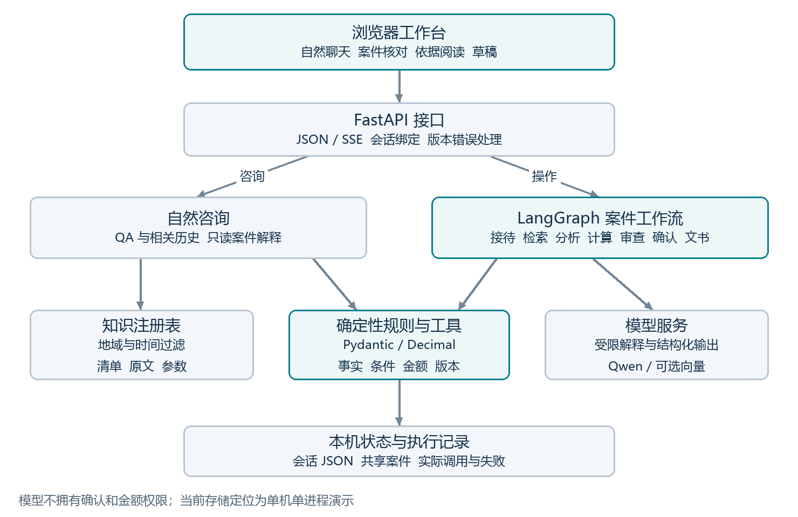
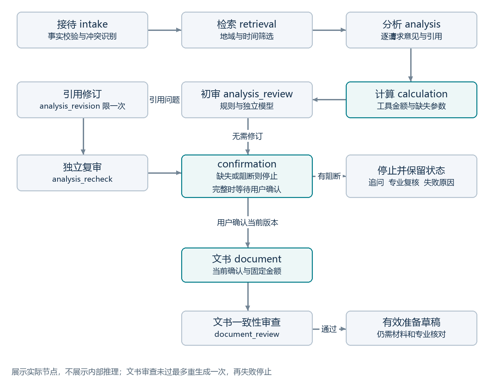
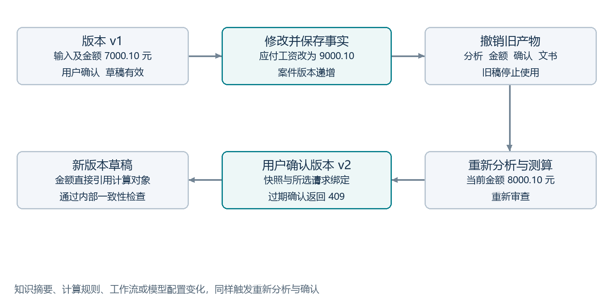
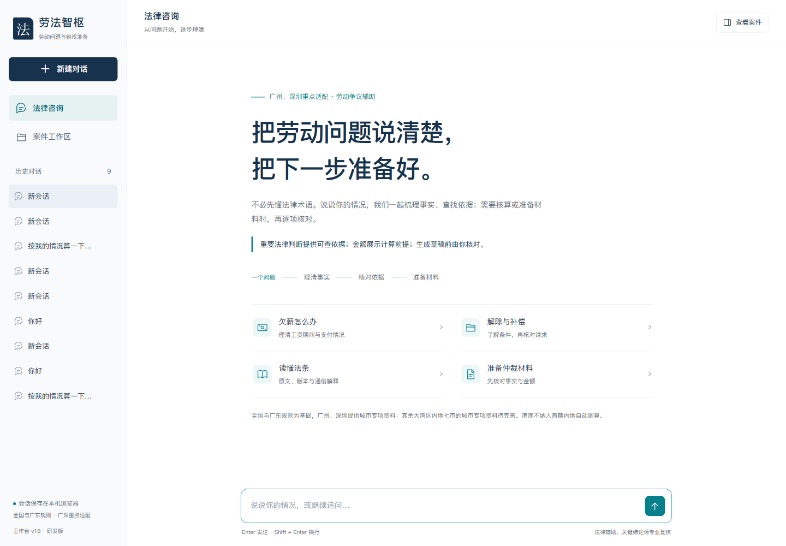

# 劳法智枢技术架构与核心创新说明

面向劳动争议维权准备的受控多智能体辅助系统

文档版本：v18 技术说明 1.0　｜　编制日期：2026年10月30日

适用对象：项目成员、指导教师、法律复核人员及科技创新竞赛评审。

本文件依据当前源码、法源清单及截至2026年10月28日的验证记录编制，说明自然咨询、案件协同、金额与文书一致性机制，以及项目创新与实际边界。系统已形成可运行的工程原型，欠薪场景能够完成事实补充、测算、确认、草稿和修订闭环。广深经济补偿封顶参数仍待专业核验，因此不能宣称劳动争议全场景自动办案。

本文件是技术说明，不是学校申报书或法律意见书。测试数字均注明测量对象和证据；本次文档编制没有重新运行全部测试、发起模型实验或开展法律专家评分。

## 阅读导航

第1至3章介绍项目与总体架构；第4至10章解释对话、协同、状态、法源、计算、审查和文书；第11至13章说明接口、前端与运行维护；第14章集中说明核心创新；第15至18章给出实例、验证、研发计划与答辩表达。附录提供源码、证据索引和术语解释。

## 1 项目定位与技术问题

### 1.1 服务对象和交付物

劳法智枢帮助劳动者及协助整理材料的法律援助人员完成劳动争议前期准备。用户可以自然提问，明确要求结合本人情况计算、分析或生成文书时，再进入案件工作区。

交付物包括法律解释、原文来源、分请求条件分析、结构化金额测算、待补材料清单及仲裁申请书草稿。用户确认表示认可当前输入、请求和金额，不表示证据真实、违法已经认定或仲裁结果获得保证。

### 1.2 需要解决的问题

劳动争议输入混有事实、情绪和法律主张。“公司突然辞退，没有补偿，也没有考勤”不能直接证明违法解除，更不能因为出现“考勤”就视为用户持有材料。错误定性一旦写入记忆，会继续污染计算和文书。

法律资料存在地域、时间和用途差异。同一条号可能属于不同法律，同一城市规则可能有历史版本，统计工资也不必然是补偿封顶的适用参数。仅检索相似文字，不能保证适用正确。

多轮修改还会产生版本漂移：应付工资由8000.10元改为9000.10元后，旧金额、确认和文书必须一起失效。各角色独立记忆或从正文再提取金额，都可能使产物不一致。

项目因此将自然解释交给模型，将条件、金额、版本和确认交给确定性程序，并以统一案件状态组织交接。[E01][E02]

### 1.3 首期范围

| 维度 | 当前实现 | 边界 |
| --- | --- | --- |
| 请求 | 欠薪、经济补偿、违法解除赔偿、代通知金 | N及2N缺已核验地方封顶参数，保留公式并阻止确认 |
| 地域 | 广州深圳重点资料，其他七市全国与广东规则 | 七市城市专项资料待完善，不借用广深数值 |
| 跨境 | 识别实际港澳或跨境履行 | 转专业复核，不自动套用内地测算 |
| 输出 | Markdown草稿、依据及材料清单 | 不自动提交仲裁、鉴真材料或代理出庭 |

港澳身份和港资企业标签本身不决定适用法律。系统依据实际履行事实识别边界，复杂法律适用仍交专业判断。

## 2 总体技术架构

### 2.1 分层设计

原生HTML、CSS和JavaScript通过FastAPI的JSON与SSE接口访问后端。后端先区分咨询和案件操作，再进入自然咨询服务或LangGraph案件图。检索、条件、金额和存储模块为各角色提供共同数据。



模型只承担受限解释与结构化生成。事实、金额、确认和产物版本的权威对象由工作流和工具维护。现有Chroma代码保留兼容用途，当前清单检索不会自动混入旧向量库。

| 层级 | 组件 | 职责 |
| --- | --- | --- |
| 交互 | index.html、workspace.css、workspace.js、casework.js | 对话、来源、核对、进度和草稿 |
| 接口 | FastAPI、JSON、SSE | 输入检查、会话绑定、错误及事件 |
| 应用 | conversation.py、QAAgent、CaseWorkflow | 咨询、只读解释和案件操作分流 |
| 协同 | LangGraph、Judge、Review、Doc | 有界交接、分析、审查和文书计划 |
| 工具 | Pydantic、Decimal、事实和条件规则 | 数据验证、金额、互斥与确认门槛 |
| 知识 | 清单、快照、index.json、可选vectors.json | 地域时间检索及参数 |
| 存储 | ConversationStateStore、浏览器状态 | 后端案件及前端编辑持久化 |
| 外部服务 | 百炼兼容接口、Qwen和Embedding | 模型输出和可选向量生成 |

### 2.2 技术选型与版本

当前前端为frontend-20261028-v18-dev，咨询为conversation-20261026-v16，案件为casework-20261026-v16，计算规则为labor-scope-20261025-v3。前端升级不代表后端算法同步变化。

FastAPI复用现有Python服务；LangGraph表达固定节点与条件分支；Pydantic拒绝未知字段及非法输入；Decimal处理货币运算；本地Marked与DOMPurify负责Markdown渲染和HTML过滤。JSON加RLock用于当前单进程演示，未引入新前端框架或事务数据库。

依赖见requirements.txt，精确本机版本见requirements-win-py312.snapshot.txt。环境快照不等于全新机器重装已经验证。

### 2.3 主路径与兼容路径

咨询主路径调用QAAgent.respond，案件由CaseWorkflow组织。RouterAgent和旧单模块run方法仍保留兼容用途，但用户无需选择Agent，旧mode字段也不能跳过确认。角色不等于独立模型：接待、检索、计算与版本检查通常为程序执行；规则模式不能称为真实模型协作。[E01][E02][E03]

## 3 用户流程与能力状态

普通咨询直接回答本轮问题，支持“试用期需要签合同吗—转正才签—为什么—怎么办”等连续追问，不强制每轮输出完整报告。寒暄和简单情绪表达使用轻量承接。

明确要求本人案件计算或文书时，进入事实澄清、法源检索、分请求分析、计算、审查、确认和草稿流程。案件内“为什么需要工资流水”属于只读解释，不改版本。编辑先保存在浏览器，明确保存才重分析。

| 能力 | 状态 | 验证边界 |
| --- | --- | --- |
| 自然多轮咨询 | 已实现 | 21项相关工程用例及有限模型抽样 |
| 欠薪核算与文书修订 | 已实现 | 规则浏览器、HTTP及有限真实模型闭环 |
| 解除条件建模 | 已实现 | 条件、否定、互斥与缺参回归 |
| 当前运行N及2N确认 | 阻断 | 封顶参数pending |
| 可选向量检索 | 已实现 | 构建和边界检查，语义质量待评 |
| 专家复核及独立盲测 | 待开展 | 复核工具和产物已准备 |
| 六人及实体手机测试 | 待开展 | 有任务表，无完成结论 |

## 4 自然对话与上下文管理

### 4.1 统一历史

ConversationStateStore按session_id保存实际用户消息和实际交付回答。后端保留最近12条turn，咨询最多读取6轮、12000字符。旧记录只有摘要时明确标注，不能补造原文。

无session_id的咨询按无历史请求处理，不读写默认共享会话；案件必须有独立session_id。这个编号用于会话隔离，不是身份认证凭据。

### 4.2 意图与只读解释

独立新问题不带入旧案工资、金额或法律标签。追问读取相关主题，明确引用本人案件才提供筛选后的只读快照；指代不明先澄清。

“工资改成9000”不能确定是应付、实付、补偿平均工资还是代通知金工资。系统先澄清口径和期间，唯一定位后才进入事实更新。模型解释、假设和法律判断不能写成用户确认事实。

### 4.3 来源校验与失败

咨询输出answer和source_ids。程序核对编号属于本轮检索、正文标记与来源对应、法名条号来自实际检索，并检查部分容易过度推断的时效和举证表达。规则校验不能证明所有法律推理正确。

自然解释使用Qwen-plus，40秒超时，无传输自动重试；格式或引用最多纠正一次。仍失败时说明本轮无法完成依据核对，保留此前有效案件。寒暄和精确法条原文查询可不调用模型。[E03][E04]

## 5 受控多智能体协同

### 5.1 图编排

LangGraph定义10类节点。常规顺序为intake、retrieval、analysis、calculation、analysis_review、confirmation。符合严格政策时插入analysis_revision和analysis_recheck；明确确认通过后再执行document和document_review。



用户确认是跨HTTP请求的业务暂停点：analyze返回待确认状态后结束，用户再发confirm请求。当前未使用LangGraph原生持久化interrupt描述这一机制。确认请求重新经过检查，避免旧分析直接出稿。

### 5.2 职责契约

| 单元 | 输入 | 输出 | 权限限制 |
| --- | --- | --- | --- |
| 接待核对 | 用户文字、facts及旧状态 | 验证事实、冲突和缺失 | 不认定违法 |
| QA检索 | 地域、时间、主题及索引 | 法规、案例和指引 | 不编造来源和参数 |
| Judge | 当前事实、请求、法源及案例 | 支持因素、不利因素、问题和引用 | 不改金额、不确认 |
| 计算工具 | 条件、期间和verified参数 | 公式、金额、假设和缺参 | 不从模型正文取金额 |
| Review | 原陈述、请求、工具结果及引用 | 分类问题和原文锚点 | 不撤销规则阻断 |
| 确认节点 | 当前版本与用户选择 | 确认快照及摘要 | 不同时修改事实 |
| Doc | 当前确认、固定金额及称持有材料 | 文书计划和规范Markdown | 不编造材料或新金额 |

### 5.3 有针对性的角色上下文

所有角色基于同一状态，但各自读取不同视图。欠薪单一请求排除不相关的补偿工资基数和解除规则；Judge可以读取参考案例处理要点及限制。

Review不读取Judge支持和不利意见，也不读取案例裁判结论，而是独立读取原始陈述、工具值和Judge引用编号。这样减少直接沿用前一角色意见的机会，但同源模型仍可能共同犯错，不能宣称独立审查已经消除偏差。

### 5.4 可观测执行

节点实际开始和结束发送task_started、task_completed，包含状态、秒数和案件版本；审查问题及等待确认分别发送review_issue、confirmation_required。展示执行记录和产物，不展示模型内部推理。

异常保存已完成阶段、原因和耗时，撤销确认并阻止可用草稿。后续检查节点可能继续运行以形成失败状态，因此节点完成不等于案件成功。[E02][E05]

## 6 案件状态与版本一致性

### 6.1 数据模型

| 字段组 | 字段 | 含义 |
| --- | --- | --- |
| 事实 | facts、fact_sources、fact_conflicts | 输入、来源、确认和未解矛盾 |
| 分析 | claims、analysis、sources、missing_info | 请求、条件意见、法源和缺口 |
| 金额 | calculations、artifacts_version | 算式、金额、假设和版本 |
| 审查 | review_issues、analysis_repair、analysis_review_history | 当前问题及修订历史 |
| 产物 | confirmation、document、document_status | 快照、草稿和可用性 |
| 执行 | stages、failures、model_calls、dependencies | 真实过程与依赖 |

CaseFacts禁止额外字段，验证日期、枚举和Decimal金额。工资最多36段，期间不重叠，结束不早于开始；null表示未知，false不能丢失。

### 6.2 事实语义

fact_sources记录结构化输入或文本提取、原陈述、版本、confirmed和evidence_verified。材料使用claimed_present、missing、unknown；用户确认后evidence_verified仍为false。

违法解除是主张，没有考勤是材料缺失，单位持有不能当作用户持有。询问、假设和仅提及不自动记为持有。冲突写入fact_conflicts，重试和重载不解除，须明确澄清。[E02][E06]

### 6.3 依赖与失效

dependencies包含知识摘要、计算规则、工作流及不含密钥的模型配置摘要。事实或依赖改变，case_version递增，旧分析、金额、确认和文书失效，并写入revisions。



确认必须携带expected_case_version，过期返回409，不能自动重试。confirmation还记录事实、计算、所选请求和知识摘要的snapshot_hash；它用于一致性识别，不是数字签名或证据认证。

### 6.4 持久化边界

case_transaction用RLock包围版本比较、执行和保存，深拷贝隔离对象；临时文件写入后os.replace。损坏JSON保留原文件并返回503。

锁覆盖模型调用，长请求会阻塞其他状态操作；这是当前演示规模的取舍。它不提供跨进程事务、多实例并发或断电持久性保证，正式部署需迁移事务数据库。[E06]

## 7 地域与时间约束知识库

### 7.1 数据入口和规模

唯一入口为data/legal_sources/manifest.json，原文网页快照在snapshots中。当前知识版本gba-2026-10-25-v1，摘要b9b3767d4c14，748条检索记录。

| 资料 | 数量 | 说明 |
| --- | ---: | --- |
| 法规版本文件 | 12 | 含新旧版本，不等于12个不同法名 |
| 办事指引 | 2 | 广州及深圳官方快照 |
| 官方出处案例参考 | 18 | 含法院典型、法援、刑事材料和仲裁裁决 |
| 参数记录 | 6 | 4条最低工资verified，2条封顶pending |
| 索引记录 | 748 | 法条、指引和案例总计 |

不能将18条参考材料称为18份生效法院判决。案例覆盖支持、不支持和举证不足方向，保留事实、争点、处理要点和限制，不能机械套用历史结论。

### 7.2 元数据与参数

法源保存id、法名、条号、原文、发布机关、官方链接、版本、地域、效力区间、核验日期和限制，摘要另存。案例分开保存发布日期、裁决日期、案号及类型。

参数按城市、purpose、适用期间、统计口径、用途、状态和来源维护。最低工资与补偿封顶分开；参数查询仅返回地域、日期、用途匹配且verified的记录，pending不得用于计算。

### 7.3 检索策略

先过滤资料类型、地域和时间，再精确匹配或排序。区间起日包含、止日不包含。完整法名与条号优先，避免劳动法47条和劳动合同法47条混淆。

普通检索采用中文词项、字符片段及长度和主题权重，属于BM25式评分，未训练专用法律语义模型。可选向量对同一已过滤集合计算余弦相似度并进行倒数排名融合，不能让不适用资料重新进入结果。

默认词项检索。向量路径已有748条1024维向量和8项精确及边界检查，但没有独立语义准确率、召回率或排序质量结论。[E07][E08]

### 7.4 历史适用处理

深圳工资条例按清单实际施行日2025年12月5日切换，不按公报网页时间切换。司法解释一32条部分废止拆分历史全文和现行存续款；精确查劳动法82条旧文本时附现行仲裁法相关说明，避免旧60日文字作为现行一般结论。

上述为已编码政策，本次未重新全面核验法律效力。全国、省、市规则不按“地方优先”机械覆盖，冲突和未确认口径保留待专业复核。

### 7.5 构建和回退

构建器核验清单、快照哈希、唯一编号和条数，在独立目录生成候选。验收后原子切换active.json并保留previous.json。两种构建入口调用同一构建器。

切换后重启服务，旧案件因知识摘要变化重新分析和确认。旧教学案例和Chroma目录不进入现行答案。[E07]

## 8 法律条件与确定性计算

### 8.1 请求成立条件

突然辞退和没有补偿不能自动推出2N，未提前通知不能自动推出N+1。条件字段的“是”仍为用户输入。

| 路径 | 核对重点 | 程序限制 |
| --- | --- | --- |
| 单位提出协商解除 | 提出方及是否达成一致 | 未明则追问 |
| 第38条解除 | 具体事由、条件和告知 | 复杂事由专业复核 |
| 第40条解除 | 类别、条件、保护和通知 | 该路径符合才考虑代通知金 |
| 第41条裁员 | 事由规模、程序和保护 | 不直接附加第40条代通知金 |
| 违法解除主张 | 事实、争议和继续履行 | 条件建模，不作认定 |
| 欠薪 | 约定、履行、应付实付和举证 | 仅核填报期间本金 |

N与2N备选，2N与代通知金不可累计确认。第39条、自愿离职等保留排除说明；零余额显示0.00元但不开放追讨零元草稿。

### 8.2 欠薪

每期未付额=max（应付减实付，0），总额为逐期未付额之和。不自动加处罚金额，不跨期间抵扣超付，不补造未填加班和奖金。

应付8000.10、实付1000得到7000.10；应付改9000.10后为8000.10。算术正确不证明应付工资已被证实，期间及争议项目仍须核对。

### 8.3 补偿和代通知金

monthly_average和previous_month_wage分开，分别服务补偿和代通知金。工龄按日历周年与半年边界，当前工具把end_date视为最后工作日再加一天比较；复杂工龄和2008年前年限需专业核验。

N及2N依赖适用城市日期的封顶和最低工资verified参数。目前广深封顶pending，因此保留公式并阻断。SYNTHETIC_TEST_CAP只用于算术测试，不进入运行库，不能用于宣称补偿闭环完成。

跨市参数适用不能仅凭cross_city_resolved勾选确定，还需专业核验。代通知金可有独立条件测算，但全案关键缺口仍阻止确认。

### 8.4 金额对象

calculations包含claim_id、amount、formula、status、assumptions、missing_parameters、parameter_ids、case_version、rule_version。金额以十进制字符串或null传输，当前以ROUND_HALF_UP保留两位。

文书直接引用对象，不从模型正文提取金额。conditional表示条件测算，pending和professional_review_required不开放可确认金额。[E09]

## 9 审查与有限修订

### 9.1 双层审查

程序检查事实、日期、法源存在、请求关系、金额和版本；模型Review补充原陈述与法条之间可能的问题。模型不能删除规则关键发现。

| 等级 | 页面文字 | 含义 |
| --- | --- | --- |
| critical | 阻止确认 | 关键条件、冲突、金额、引用或执行问题 |
| warning | 待核实 | 材料、主体占位或需核验事项 |
| info | 补充说明 | 适用边界和操作说明 |

等级是处理优先级，不是败诉概率。缺证据不等于事实不存在，主体缺失可保留占位；这两类为草稿提示政策，不能放宽法律条件或金额问题。

### 9.2 审查锚点

source_ids与fact_fields分开。关键问题须给law_excerpts本轮法源连续原文和fact_excerpts实际输入或工具值，真实空缺用missing_fact_fields。后端核对编号、路径、原值和片段，不代填必填字段。

锚点通过只证明片段来自输入，不证明法律推理正确。法律专业性仍需逐案人工评价。[E10]

### 9.3 有限纠正

JSON格式或引用纠正最多一次，length截断即使可解析也失败。业务分析修订是另一上限：无缺参、失败或规则关键阻断，且关键发现全部是符合政策的Judge引用问题，才回交Judge一次。

修订保护事实、来源、请求、计算、依赖、确认和文书，越权改动恢复并阻断；随后重新独立Review，不向其提供此前结论。复审失败停止，不再循环。历史保留最近20次初审与复审，不回灌新案件。

文书一致性检查另有一次重新生成上限，不应与结构化纠正或引用修订合称无限自我改进。[E05][E10]

## 10 用户确认与文书生成

确认检查版本、缺失、失败、关键审查、请求可选性、金额及互斥。confirm不得同时改事实，修改须先analyze。

模型启用时Doc输出DocumentPlan，requests复制approved_requests，evidence_names来自称持有材料；程序校验后由规范模板生成Markdown。金额来自calculations，限制模型自由改写金额和证据。

草稿有主体、请求、事实理由、工资期间、依据、证据和签名日期。主体缺项保留【待补充】，具体仲裁委员会待核验。目录只列称持有且关联所选请求的材料，不表示验真。

文书审查核对请求、金额、版本、事实快照和材料关系。只有reviewed_draft可作为当前可复制草稿；“内部一致性检查通过”不是专家审核或法律效力证明。[E02][E05]

## 11 API与事件协议

### 11.1 契约

POST /api/chat和POST /api/chat/stream保留reply、answer、route、structured。workflow为consultation或case。咨询presentation.kind=conversation；案件前端兼容workflow及已有案件对象。旧mode接收不代表可绕过流程。

| 字段 | 含义 | 约束 |
| --- | --- | --- |
| query | 本轮原始文字 | 不等于核验事实 |
| session_id | 会话边界 | 案件必填，不是认证 |
| workflow | 咨询或案件 | 未知值422 |
| action | analyze、confirm、generate_document | 明确操作 |
| facts | 部分事实补充 | 工资列表替换，材料按名合并 |
| expected_case_version | 版本核对 | 确认必填整数 |
| selected_claims | 当前所选请求 | 满足可选和互斥条件 |

### 11.2 合成示例

初次分析仍需根据missing_info补条件。金额使用字符串。

```json
{
  "workflow": "case",
  "session_id": "technical-demo",
  "action": "analyze",
  "facts": {
    "workplace": "广州",
    "employer_city": "广州",
    "dispute_date": "2026-10-01",
    "wages": [{"start": "2026-09-01", "end": "2026-09-30", "due": "8000.10", "paid": "1000.00"}]
  }
}
```

确认中的版本必须替换为实际当前版本。

```json
{
  "workflow": "case",
  "session_id": "technical-demo",
  "action": "confirm",
  "expected_case_version": 1,
  "selected_claims": ["arrears"]
}
```

### 11.3 事件和错误

咨询发送thinking后，完成依据检查再发送route、structured、token、done。token是已生成正文的传输片段，不是实时模型生成，done.token_count不用于计费。真实用量在模型记录中。

案件发送真实节点开始、完成、审查和确认事件。已知过期版本在SSE开始前409，流中错误用error事件；非法输入422，损坏存储503。遇409客户端停止旧确认、要求显式同步，不能自动确认新金额。[E11]

## 12 v18前端与可解释交互

### 12.1 页面结构

咨询保持自然气泡，案件、依据和草稿在详情区。1440像素三栏，1024抽屉，390全屏详情；普通解释不重复完整案件报告。



### 12.2 渐进核对和引用

新案件采用基本情况、争议与工资、材料持有三步，可切完整表单。切步骤不销毁字段，保留false和隐藏条件；刷新恢复编辑，切会话有未保存保护，明确保存才提交。

地域覆盖与本轮来源分开。来源绑定原消息，实际引用标记可返回对应位置和高亮。只有检索而没有标记时，只说明本轮检索依据，不构造逐句支持关系。

### 12.3 有效状态

案件展示真实阶段，普通咨询轻量等待。问题文字、图标、色条共同分级，关键项展开。有效当前草稿才有材料准备摘要；编辑、案件执行、409和中断时暂停旧稿及复制。历史只读，迟到结果只更新原会话。

焦点管理、aria-live、减少动态效果和安全Markdown已有工程检查。窄屏模拟不能代替实体手机键盘和放大体验，仍需真人测试。[E12]

## 13 运行维护与数据边界

### 13.1 模式与启动

当前本机Python3.12环境可使用以下命令。正式安装步骤与参数以README为准。

```powershell
.\venv\Scripts\python.exe build_db.py --activate
$env:CASE_MODEL_ENABLED="0"
.\venv\Scripts\python.exe start_server.py
```

CASE_MODEL_ENABLED只控制案件图模型，自然解释仍可能联网。完全离线可以演示精确法条、寒暄和规则欠薪，不能宣称所有咨询离线。密钥和工作空间兼容地址只放本机.env，不进入文档。

| 路径 | 配置 | 边界 |
| --- | --- | --- |
| 自然解释 | Qwen-plus，40秒 | 无传输重试，纠正一次 |
| Judge和Doc | Qwen-plus，60秒，2400输出 | temperature 0.1，JSON，无SDK重试 |
| Review默认 | Qwen-plus，同上 | 与生产可选配置分开 |
| Review可选 | qwen3.8-max，90秒，4096输出 | low档，不改变冻结对照 |

调用记录实际返回模型、finish_reason、usage和耗时。未知用量保持null或unknown，不按零成本，不用请求模型名冒充实际返回名。

### 13.2 数据与安全

劳动关系、工资和主体信息保存在本机JSON及浏览器。筛选后的角色输入会发到配置模型服务，不能宣传全部数据不出本机。

session_id不是身份认证；当前不等于具备生产授权、加密存储、保留删除策略、访问审计或全面提示注入防护。DATA标为不可信并受Schema和权限校验限制，但不能据此声称安全问题已全面解决。

公开演示使用合成或脱敏数据，不提交.env、私有会话、venv和索引。外部部署前补身份授权、数据告知、事务存储、限流和安全验证。

### 13.3 维护纪律

知识更新先下载快照、检查差异与效力，再构建激活；采集不自动认定适用。v18本轮未打包，保留v17和v16包，不能用旧包哈希证明当前全部工作文件。法律规则或模型配置变化要重新分析确认。

## 14 核心创新与证据

### 14.1 创新定位

贡献集中于劳动争议的流程、语义和约束，属于应用及系统集成创新。没有训练新基础模型，没有证明首创通用多Agent算法、全面消除幻觉或显著提升法律准确率。

| 贡献 | 机制 | 已有证据 | 尚未证明 |
| --- | --- | --- | --- |
| 受控协同 | 权限、共享状态、有限修订和确认暂停 | 真实节点及失败审查记录 | 普遍优于单Agent |
| 可失效产物 | 依赖版本联动金额确认草稿 | 工资修订、409和重确认 | 多实例生产事务 |
| 地域时间检索 | 清单、精确引用、历史和缺参阻断 | 城市版本边界及pending测试 | 全国全业务全历史 |
| 事实判断分离 | 主张、持有、确认与验真分开 | 否定、冲突和来源追踪 | 完备语言理解与鉴真 |
| 金额文书同源 | Decimal、确认快照和规范渲染 | 7000.10至8000.10联动 | 全部规则已专家核验 |

### 14.2 受控交接

模型分析不拥有金额，审查不能放行规则，文书不能补材料，引用修订保护核心字段。“协同”因此有可检查的交接对象，可研究职责隔离如何限制错误传播。

代价是调用、延迟和误报增加。当前完整组自动标记未优于无审查组，仍须改进和人工评价，不能只以流程齐全证明收益。

### 14.3 版本依赖联动

系统管理哪些产物仍有效，而不是只记住聊天。事实、知识或模型策略变化同步撤销下游；确认绑定版本和快照，避免误用旧稿。该工程机制已有证据，实际服务收益仍需法援和用户研究。

### 14.4 可核验的地域适配

地域通过检索前过滤、历史版本、参数用途和缺口说明落地。深圳版本、部分废止和广深封顶pending可演示系统如何处理真实资料差异。适配尚不完整，后续按专业核验和边界回归扩大。

### 14.5 事实语义和同源输出

把用户陈述、法律主张、材料持有与验真分开，避免关键词直接变结论；计算和文书共用对象，减少二次文本转换和版本漂移。跨领域迁移是设计潜力，尚未经验证。

### 14.6 对比的范围

可以比较自由生成、仅检索增强和受控工作流三种抽象架构的控制点，但这不是对商业法律AI的实测评价。对外部产品做准确率、成本或专业性排名，需要共同任务和可复核协议。

## 15 典型场景

### 15.1 欠薪正向闭环

合成用户输入广州、日期及应付8000.10和实付1000，补工资约定、劳动履行和材料状态。系统检索审查后给7000.10元公式并等待确认，确认后草稿金额与工资表一致。

应付改为9000.10时，前端先暂停旧稿复制；保存后版本递增、确认撤销，新本金8000.10。再次核对确认才出新稿。该场景同时展示多轮、工具、暂停、失效和同源输出。[E12]

### 15.2 条件不足与跨境反例

仅说突然辞退或无补偿，系统追问解除理由和条件，不直接2N；即便部分事实齐全，当前封顶pending仍阻断。实际港澳履行或actual_cross_border_work触发专业复核，点击确认不能绕过。

未出稿有时是正确阻断，应按输入条件判定，而非全部视为失败；无依据的过度阻断也需计入误报。

### 15.3 解释和会话隔离

有效草稿后问工资流水用途，普通解释不改案件版本，失败也保留草稿。请求中切换会话，迟到响应只能更新原会话，不能替换当前来源或案件。

## 16 验证体系与实验结果

### 16.1 证据层次

工程测试检查契约，公开案例检查已知任务，真实模型抽样观察配置行为，法律人工评分检查适用，用户研究检查实际任务完成。这些证据不能互相替代。以下均来自截至2026年10月28日记录，本次未冒称重新执行。

| 项目 | 记录结果 | 可支持结论 |
| --- | --- | --- |
| Python回归 | 146通过 | 所覆盖契约符合预期 |
| 前端控制器 | 13通过 | 已测状态与隔离行为 |
| 冻结工程v2 | 60案通过 | 公开工程检查通过 |
| 浏览器主流程 | 32项通过 | 本机合成交互可复现 |
| 异常边界 | 19项通过 | 已测409、失败和阻断 |
| 布局 | 1440、1024、390 | 已测视口无横向溢出 |
| 法律专家 | 未完成 | 无专家审核及法律准确率 |
| 六人及实体手机 | 未完成 | 无真人完成结论 |

浏览器出现预期409和主动ERR_FAILED两条资源错误，无其他已观察JS异常。进度观察仅延迟真实SSE交付65毫秒便于观看，不替换事件、不作为模型耗时。[E12]

### 16.2 六十案组成

解除20、欠薪10、地域版本10、多轮修正10、否定缺失10，附SHA256。输入公开且开发可读，不能称盲测。v2仅修正三个零余额确认预期，输入及金额不改；保留v1在新行为下57/60记录，不能把预期修正当能力提升。

### 16.3 固定模型对照

三组共享Qwen-plus、采样、法源和工具结果，不提供预期、评分或生产意见；每组60，共180产物及360次成功调用。[E13]

| 组别 | 产物 | 自动标记 | 调用 | 已报告token | 角色耗时中位数 |
| --- | ---: | ---: | ---: | ---: | ---: |
| 单Agent | 60 | 15 | 60 | 791864 | 4.828秒 |
| 协同无审查 | 60 | 2 | 120 | 1588002 | 7.125秒 |
| 协同有审查 | 60 | 8 | 180 | 2402071 | 7.312秒 |

标记检查结构、引用、工具金额、请求和门槛，不是法律错误率。增加审查未在该指标改善；不可称稳定收益。耗时为角色调用，不是端到端等待；token非完整办案成本。

这是共享工具下的结构化决策实验，不是生产吞吐；无独立重复、盲测、专家评分或显著性证明。早期401和超时试跑另存，未并入。

### 16.4 生产抽样和人工复核

v15十个扩展场景9项符合严格工程预期，1项90秒审查超时停止出稿，其中1项规则提前终止不计模型调用。不同协议与混合模型不能同全Plus实验合并统计。[E14]

已准备60份规则产物和180份真实模型复核包，评分仍待审。应分事实、地域时间、条件、请求关系、证据、金额、来源及确认文书评分，严重错误单列。[E15]

后续同时评价法律质量、审查误报、严重错误、调用和端到端耗时；用户研究记录首次任务成功、耗时和误解，不只挑有利数字。

## 17 限制与研发优先级

| 优先级 | 工作 | 完成标准 |
| --- | --- | --- |
| P0 | 广深封顶口径 | 专业确认、来源、verified及年度回归 |
| P0 | 教师或律师复核 | 可核验身份日期、逐案意见和修复回测 |
| P0 | 审查误报超时 | 分类现有样本并独立复测 |
| P0 | 六人和实体手机 | 实际任务及问题修复记录 |
| P1 | 盲测和公平消融 | 新任务隔离，冻结协议，公开失败 |
| P1 | 外部部署 | 身份授权、事务、数据政策和安全验证 |
| P2 | 业务地域扩展 | 现有闭环质量达标后逐项增加 |

当前不覆盖全部历史、特殊用工、2008年前工龄或复杂跨市跨境。规则理解不完备，审查会漏报或误报。没有OCR、上传、鉴真和自动提交。继续增加Agent或装饰性进度不能替代专业与用户证据。

## 18 答辩表达与贡献归属

推荐描述：劳法智枢围绕劳动争议维权准备，构建共享案件状态驱动的受控多智能体流程，通过地域时间约束检索、事实与主张分离、确定性计算、版本确认和一致性审查，形成可追溯、可复核且能随修改失效的准备草稿。已有工程验证和有限真实模型记录，专业评分与独立盲测待完成。

展示先解释模型、规则和用户权限，再用欠薪修订演示金额如何入稿，随后展示条件不足或跨境阻断，最后报告实验及限制。

自研贡献是案件状态、角色契约、依赖联动、清单检索和核对交互；第三方包括Qwen、LangGraph、FastAPI、官方法源及渲染库。没有自训基础模型，不写自研大模型。

不能把60/60写成100%法律准确率，把无标记写成胜诉率，或宣称专家审核、大湾区全法律覆盖、协同显著优于单Agent、已降低实际维权成本或提高仲裁成功率。后两类服务效果需真实研究支持。

## 附录A 源码索引

路径相对项目根目录，按函数定位，行号随研发变化。

| 路径 | 定位 |
| --- | --- |
| legal_ai_agent/api/server.py | 咨询案件分流、SSE与错误 |
| legal_ai_agent/conversation.py | wants_case、context_for、wage_revision |
| legal_ai_agent/agents/qa_agent.py | respond、_messages、_validate |
| legal_ai_agent/casework/workflow.py | 图、失效、确认及payload |
| legal_ai_agent/casework/models.py | CaseFacts、WagePeriod |
| legal_ai_agent/casework/facts.py | 文本提取 |
| legal_ai_agent/casework/evidence.py | 材料持有识别 |
| legal_ai_agent/casework/fact_checks.py | 在职与日期矛盾 |
| legal_ai_agent/casework/conditions.py | 解除条件 |
| legal_ai_agent/casework/calculation.py | calculate、service_units |
| legal_ai_agent/casework/knowledge.py | 清单、过滤与索引 |
| legal_ai_agent/casework/roles.py | Schema、上下文、Review与文书 |
| legal_ai_agent/casework/review_grounding.py | 原文锚点 |
| legal_ai_agent/casework/review_revision.py | 一次修订及状态保护 |
| legal_ai_agent/casework/model_policy.py | 模型配置与摘要 |
| legal_ai_agent/casework/model_observation.py | 输出及异常用量 |
| legal_ai_agent/memory/memory_manager.py | 历史和案件事务 |
| frontend/workspace.js、casework.js | 会话控制、来源、引导与草稿 |

## 附录B 证据索引

| 编号 | 资料 | 用途 |
| --- | --- | --- |
| E01 | docs/ARCHITECTURE.md、docs/ROLE_CONTEXT_CONTRACT.md | 架构及权限，结合源码 |
| E02 | legal_ai_agent/casework/workflow.py | 图和版本确认 |
| E03 | legal_ai_agent/conversation.py | 意图和只读解释 |
| E04 | legal_ai_agent/agents/qa_agent.py、legal_ai_agent/memory/memory_manager.py | 依据和历史 |
| E05 | legal_ai_agent/casework/roles.py | 角色与规范渲染 |
| E06 | legal_ai_agent/memory/memory_manager.py | 锁、保存和503 |
| E07 | data/legal_sources/manifest.json、legal_ai_agent/casework/knowledge.py | 清单和适用 |
| E08 | docs/evaluation/casework_v2/vector_build_check.json及vector_retrieval_check.json | 向量有限验收 |
| E09 | legal_ai_agent/casework/calculation.py及conditions.py | 计算和条件 |
| E10 | legal_ai_agent/casework/review_grounding.py及review_revision.py | 锚点与修订 |
| E11 | docs/API.md、legal_ai_agent/api/server.py | 协议 |
| E12 | docs/evaluation/frontend_v18/validation.json、FINDINGS.md及浏览器JSON | v18工程记录 |
| E13 | docs/evaluation/casework_v2/MEASURED_MODEL_RESULTS.md及model_ablation.json | 三组实验 |
| E14 | docs/evaluation/casework_v2/LIVE_SCENARIO_FINDINGS.md及live_scenarios_v15_mixed | 真实抽样 |
| E15 | docs/evaluation/casework_v2/LEGAL_REVIEW_WORKFLOW.md及复核包 | 待审产物 |

表中同目录的缩写文件沿用首个完整前缀。运行结论以原始JSON及协议为准，早期文档数字不替代当前验证。

## 附录C 术语

| 术语 | 本项目含义 |
| --- | --- |
| Agent或角色 | 有输入范围、输出契约和职责的单元，可为规则或模型 |
| 共享状态 | 事实、请求、来源、金额、确认和文书的统一对象 |
| RAG | 先检索，再提供受限依据辅助生成 |
| 条件测算 | 输入与条件下的算术，不表示请求成立 |
| 确认 | 认可输入请求金额，不代表验真 |
| 内部一致性检查 | 核对请求、金额、版本和材料关系 |
| 工程通过率 | 契约测试通过，不等于法律准确率 |
| 自动标记 | 检查器提示需复核，不等于法律错误 |
| 知识摘要 | 清单内容摘要，用于版本依赖 |
| 草稿可用 | 当前通过门槛可复制，仍需材料及专业核对 |
