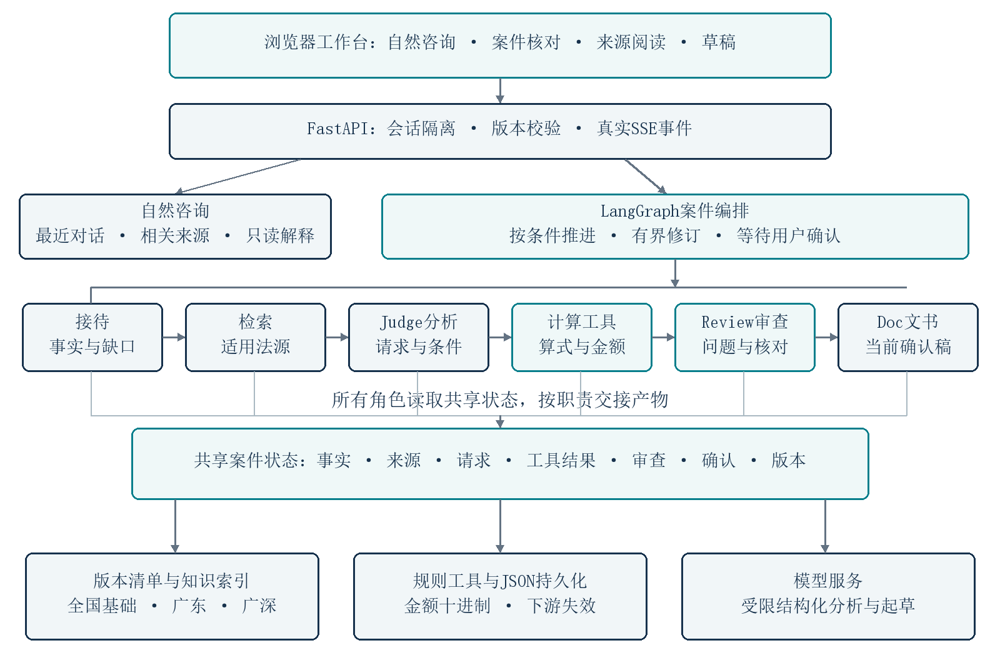
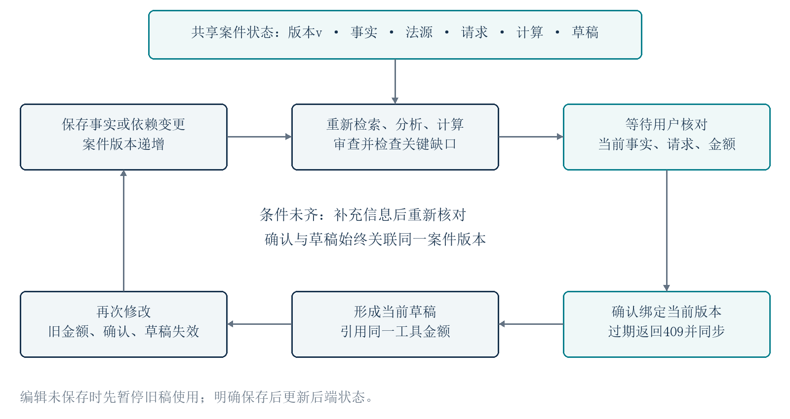
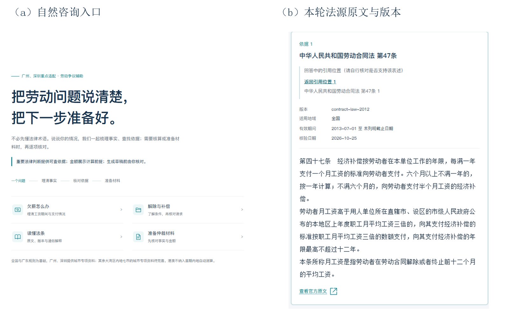
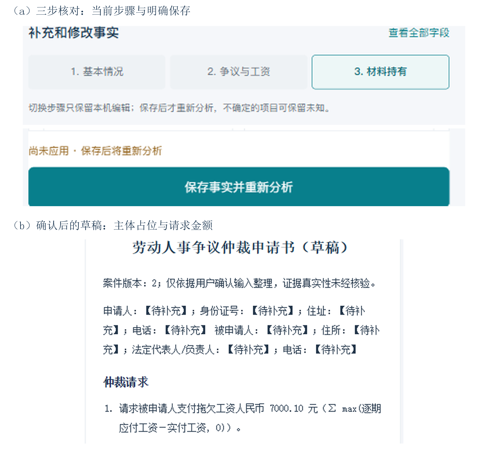
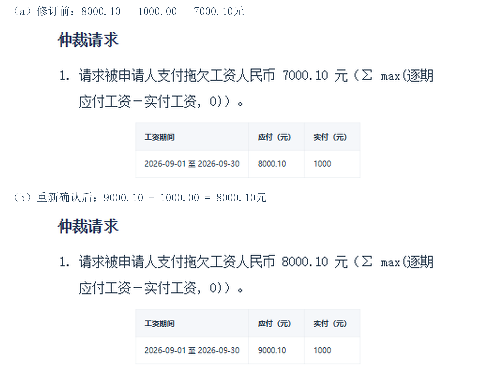
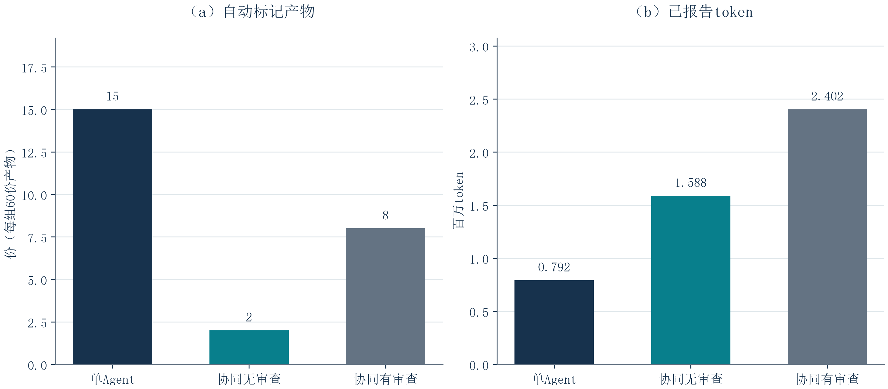
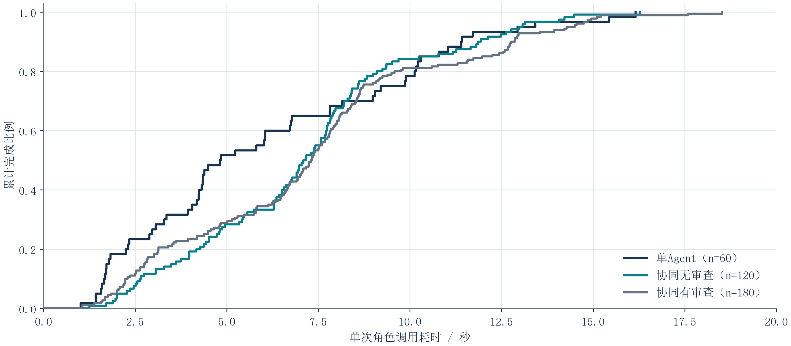

# 劳法智枢研究与开发报告

参赛版

作品名称：劳法智枢-面向粤港澳劳动争议维权准备的受控多智能体辅助系统

劳法智枢项目组

2026年11月2日

## 摘要

劳法智枢是一套面向劳动者和法律援助材料整理人员的劳动争议辅助系统。针对案情陈述与法律判断混杂、地域和历史法源适用复杂、计算结果与文书容易脱节等问题，项目建立全国基础法源、广东规则及广深城市资料相结合的知识组织方式，以共享案件状态驱动接待、检索、分析、计算、审查和文书等协作单元。系统提供自然多轮咨询与渐进式案件核对，将大模型的解释、分析和起草能力，与确定性计算、版本校验和用户确认连接，形成从问题描述到仲裁材料草稿的连续工作流程。

作品已完成v18工作台，实现来源原文阅读、真实阶段进度、三步事实核对、请求金额确认和材料准备摘要。欠薪场景已走通分期核算、草稿生成、工资修订和再次确认，金额与文书保持同源。现有知识资产形成748条检索记录；既有146项Python回归、13项前端控制器测试和60案工程任务通过，另保存浏览器主流程与异常边界记录。项目完成了同模型条件下的三组对照实验，共180份产物、360次成功模型调用，为分析职责拆分、审查和调用代价提供了实测材料。

本作品的核心特点是将法律辅助的专业性落实为可检查的数据流程：事实有来源，法源有适用范围，金额有算式，确认绑定版本，修订触发下游同步更新。后续将完善城市参数，组织法律专业评价和真实用户试用，推动成果进入高校法律服务、工会及法律援助材料预整理场景。

关键词：劳动争议；多智能体协同；地域法源；确定性计算；版本一致性

## 目录

<!-- WORD_TOC -->

## 1 研究背景与需求分析

### 1.1 劳动争议准备的现实需求

工资支付、劳动合同解除和仲裁材料准备与劳动者的切身利益直接相关。劳动者向专业人员求助之前，往往需要先整理入离职日期、工资期间、单位情况、已收款项和手中材料。这项工作看似简单，实际涉及事实、证据、法律规则和计算口径的反复核对。司法部开展维护劳动者合法权益法律援助“安心行动”，将劳动报酬追索与证据整理纳入服务重点，为面向劳动者的材料辅助工具提供了明确的应用方向。[9]

法律AI正在从知识查询走向任务执行。现有产品已覆盖法律咨询、法规检索、文书起草和多步骤研究，但劳动者在准备一份具体材料时，还需要清楚知道“下一项补什么”“金额从哪里来”“修改后哪些材料需要更新”。劳法智枢选择这一连续任务作为研发对象，把自然语言入口与可核对的准备流程结合起来。

### 1.2 目标用户与关键任务

（1）劳动者。用户能够使用日常语言描述问题，通过少量关键追问逐步提供地域、日期、工资和材料信息，查阅相关依据，并核对系统整理的请求和金额。

（2）法律援助、工会及高校法律服务的材料整理人员。辅助人员能够利用同一案件对象查看事实、来源、缺口和修订结果，把初步案情转化为方便后续专业复核的材料。

（3）教学与项目评审人员。通过合成案例观察事实、法源、算式和文书之间的数据关系，并依据保存的测试产物复核系统行为。软件的运行与实验过程均配有可定位的材料索引。

### 1.3 需要解决的技术问题

（1）事实语义容易混淆。“没有考勤”属于材料缺失，“我认为公司违法解除”属于用户主张，“应付8000.10元、已付1000元”属于待核对的金额输入。系统需要保存各自语义，使后续分析读取正确的事实状态。

（2）法律来源具有适用条件。相同条号可能属于不同法律，地方规则具有城市和历史版本差异，最低工资与补偿封顶工资参数又有不同用途。检索应先确定地域、时间和资料类型，再对候选内容排序。

（3）多轮任务容易发生数据漂移。工资、日期或地域修改后，分析、测算、确认和草稿必须更新到同一版本。若只调整页面数字而继续保留旧稿，准备材料就会出现内部矛盾。

（4）专业流程需要易懂的交互。普通咨询适合直接回答；案件准备则需要分步核对、计算前提和清楚的确认节点。项目据此设计统一聊天入口与独立案件工作区，将复杂能力安排在用户能够理解的步骤中。

## 2 国内外研究与竞品对比

### 2.1 法律大模型与评测研究

国内研究已形成法律领域模型、知识增强与专门评测等方向。LawBench通过20类中文法律任务，从记忆、理解和应用层面观察模型能力；Chatlaw的2026年修订研究将角色协作与专门模型结构结合，体现了以法律工作分工组织AI能力的技术路径。[1—2]

国外研究同时关注能力测量与输出依据。LegalBench由跨学科团队组织162项法律推理任务；L-MARS将检索、协作与引用支持性核查结合；2026年10月发布的LawCompass进一步把咨询、专业检索和多智能体研究连为工作环境。[3—5]这些研究说明，法律AI的评价对象正在由“是否答出问题”扩展至“引用、推理和产出如何相互对应”。

本项目将这一方向用于劳动争议准备：把事实字段交接、地域时间筛选、工具金额和文书版本纳入同一流程，研究通用模型能力在具体业务约束下的组织方式。相关研究为设计提供依据，项目效果则由自身测试协议和原始产物支撑。

### 2.2 代表产品与差异化比较

通义法睿提供法律咨询、案例与法规检索、文本阅读、文书生成及合同审查等法律能力；Harvey以Threads、Vault和Workflows组织专业法律工作；2026年版CoCounsel Legal把研究、分析、起草与核验安排在连贯的案件工作环境中。[6—8]本项目吸收统一入口、来源阅读和人工参与的设计，进一步围绕劳动者核对金额与准备材料优化。

表1从目标任务及具体交付机制比较代表产品。竞品内容据官方公开资料整理，核验日期为2026年11月2日；本项目内容据实际源码和验证材料整理。比较突出面向广深劳动争议准备的适配方式。

表1 代表法律AI产品与劳法智枢的场景比较

| 比较维度 | 通义法睿 | Harvey | CoCounsel Legal | 劳法智枢 |
| --- | --- | --- | --- | --- |
| 主要用户 | 多类法律服务用户与应用开发者 | 法律专业人员 | 律所与企业法务 | 劳动者及法援材料整理人员 |
| 服务任务 | 咨询、检索、分析、起草与审查 | 研究、文档分析与工作流 | 研究、分析、起草及核验 | 劳动争议咨询到材料准备 |
| 知识组织 | 法律行业知识与检索能力 | 专业来源及工作资料 | Westlaw与Practical Law等内容 | 全国＋广东＋广深地域时间资料 |
| 核心交付 | 法律问答、检索及文书等 | 可引用、可修订的工作产物 | 依据支撑的法律工作产物 | 工具算式、金额、草稿同源 |
| 人工核对 | 按任务输入与规则交互 | 在对话中核验、修订与引用 | 专业人员控制论点与决策 | 三步核对后确认当前事实及金额 |
| 本场景特点 | 法律能力接口丰富 | 专业文档与研究环境 | 综合法律内容与任务执行 | 事实修改联动金额、确认与旧稿 |

资料来源：官方产品资料[6—8]及项目源码、v18验证记录[10—12]。

### 2.3 本作品的优势与切入点

（1）面向普通劳动者降低操作门槛。系统以自然聊天接待问题，按需进入“基本情况—争议与工资—材料持有”的渐进核对，用户无须理解后台Agent或一次填写全部字段。

（2）将地域资料转化为可检查的检索条件。每条记录保留法名、条款、地域、版本和有效区间；精确查询先锁定法名条号，一般检索在适用集合中进行。

（3）打通计算与文书。请求金额来自确定性工具，用户确认之后由规范模板引用；同一数据对象同时支撑算式、金额卡和申请书请求。

（4）将多轮修改纳入质量控制。工资变更触发版本更新，旧确认和草稿立即停止作为当前产物使用，重新核算并再次确认后形成新稿。该机制可以通过实际界面和测试记录同时核验。

## 3 作品设计与业务流程

### 3.1 作品定位与地域组织

作品名称沿用正式申报信息“劳法智枢-面向粤港澳劳动争议维权准备的受控多智能体辅助系统”。当前版本以大湾区内地劳动争议为应用基础，重点建设广州、深圳资料，采用全国基础法源、广东规则和城市适配的分层结构。

业务围绕欠薪、经济补偿、违法解除赔偿和代通知金展开。欠薪本金核对与草稿修订已形成完整展示链路；解除相关业务以成立条件、工资口径和请求关系为中心组织分析。城市参数有独立核验状态，使资料完善进度与具体测算前提在页面上可见。

普通咨询交付直接回答及本轮依据；案件准备交付事实核对、条件分析、工具测算、材料清单和仲裁申请书草稿。作品以辅助准备和专业复核衔接为定位，用户确认用于锁定当前输入、请求和金额。

### 3.2 从咨询到材料准备的流程

（1）自然咨询。系统结合最近六轮实际对话承接追问。对“N+1是什么意思”等概念问题作解释；对“第二点是什么意思”等指代，读取相关历史；不明指代先澄清。

（2）明确案件任务。用户要求“按我的情况计算”或“准备仲裁申请书”后，系统进入案件核对。接待单元提取结构化事实，集中提出当前关键缺口，完整字段在工作区查看。

（3）检索、分析与计算。按地域和争议时间检索法源，分析各请求的条件和材料需求，再调用规则工具形成金额及前提。分析审查检查输入冲突、请求关系、引用和金额。

（4）用户确认与草稿。案件具备可确认条件时，用户核对当前事实、请求和金额。文书单元以确认对象生成草稿，再作一致性审查；界面展示待补主体信息和材料准备摘要。

（5）修订与再次确认。用户保存新事实后，系统重新执行受影响的阶段；旧金额、确认和草稿同步失效。新的计算和确认完成后，生成与当前案件一致的材料。

### 3.3 代表性欠薪任务

以广州一个合成欠薪案件为例：争议日期2026年10月1日，工资期间为2026年9月1日至30日，应付8000.10元，实付1000.00元；用户称持有工资流水，考勤材料缺失。系统保存材料状态，检索工资支付与举证相关依据，计算待核本金7000.10元，经确认形成草稿。

将该期应付改为9000.10元后，待核本金调整为8000.10元，旧确认及草稿失效。用户再次确认后，新稿的请求金额和工资明细同步更新。这一任务同时验证事实语义、算术、人工核对和文书依赖，是第6章界面展示与第7章工程测试共用的实例。

## 4 总体架构与关键技术

### 4.1 分层架构与协作职责

系统由浏览器工作台、FastAPI接口、自然咨询与LangGraph案件流程、规则工具、清单知识和JSON状态存储组成。HTML、CSS和JavaScript实现交互；JSON接口传递结构化请求与结果；SSE输出节点真实执行事件。图1展示总体依赖及协作单元。

资料来源：项目当前源码与技术说明[10]，图示概括主要依赖。

接待负责整理输入和缺口；检索返回适用来源；Judge分析分请求成立条件；计算工具负责金额；Review核对条件、来源和一致性；Doc负责文书计划与规范模板衔接。各单元围绕同一案件状态运行，其中检索、计算和版本检查可由程序直接执行，模型承担解释、分析与起草任务。

LangGraph配置接待、检索、分析、计算、分析审查、确认、文书和文书审查等节点，另设有界修订与复审，共10类节点。用户确认通过前端独立操作跨请求完成，流程在等待确认处暂停业务推进，接到当前版本确认后继续处理。

### 4.2 事实提取与数据校验

项目提取的是具有明确用途的业务字段。地域和日期决定法源筛选，解除原因及通知信息进入条件核对，逐期应付与实付进入计算，材料状态约束证据目录。表2给出字段如何从原陈述进入后续协作。

表2 关键事实字段及其使用方式

| 字段类别 | 提取内容 | 后续用途与负责单元 |
| --- | --- | --- |
| 地域与时间 | 履行地、单位所在地、争议日期 | 检索单元筛选地域和有效版本 |
| 劳动关系 | 入职、离职、在职状态 | 接待校验时间；分析核对条件 |
| 解除情形 | 提出方、理由、通知、程序、保护情形 | Judge与规则检查请求条件 |
| 工资与期间 | 补偿平均工资、上月工资、逐期应付及实付 | 计算工具按用途分开核算 |
| 材料与主张 | 称持有、缺失、未知；用户法律主张 | Review与Doc核对材料和表达 |
| 来源与确认 | 原陈述、录入方式、确认和版本 | 共享状态追溯输入及变更 |

资料来源：CaseFacts、事实提取与材料检查模块[10]。

Pydantic检查日期、枚举、金额和字段范围；工资期间最多36段，起止顺序正确且相互不重叠。未知值和明确否定分别保存。例如，“没有考勤”进入材料缺失状态，“我认为违法解除”进入用户主张，后续分析再核对其成立条件。

每项事实保留来源和确认状态；用户核对输入后增加确认标记，材料真实性仍由相应证据和专业程序判断。通过这种表达，系统可以在较早阶段保留不确定信息，同时让后续角色知道哪些数据可以用于算式、哪些还需要补充。

### 4.3 地域时间检索与法源版本

法源构建采用单一版本清单入口。当前资料包括12份法规版本文件、2份办事指引和18条官方出处参考材料，形成748条检索记录。记录保存唯一编号、法名、条款、原文、发布机关、官方链接、地域、有效区间、核验日期和适用限制。城市参数另行管理，区分最低工资与补偿封顶等用途。

检索首先形成满足地域、时间和类型条件的候选集合，再执行内容排序，其过程用式（1）表示。

$$FILTER$$

式中，D为清单记录集合，r为地域，t为争议日期，k为资料类型；R、T、K分别表示对应条件是否满足。有效期间按起日包含、止日不包含处理，适用关系仍依据配置核对。

用户指定《劳动法》第47条或《劳动合同法》第47条时，系统先按完整法名与条号定位。一般问题默认使用词项与字符片段的BM25式评分；可选向量检索在同一候选集合中融合排名。当前已取得748条1024维向量，并保存8项精确检索及地域时间边界检查，作为可选检索路径的构建证据。

索引在独立目录构建、验收后切换，并保留前一版本。知识版本摘要随案件保存，资料变更可触发相关产物重新核对，使检索依据与案件状态保持关联。

### 4.4 确定性计算与请求条件

欠薪核算把每个通过期间校验的工资段作为计算单元，读取应付与实付，使用Decimal十进制运算，最后按两位小数输出。式（2）给出填报期间的本金汇总方法。

$$ARREARS$$

式中，m为工资段数，dᵢ和pᵢ分别为第i段应付与实付，A为所填期间待核本金。系统逐段保留算式与输入，便于用户追溯差额。该工具围绕填报本金核对，其他工资项目可在事实与请求明确后分别处理。

解除相关请求采用条件表组织。补偿平均工资与代通知金相关工资分开保存，解除提出方、原因、通知及程序进入不同分支。经济补偿、违法解除赔偿和代通知金之间的备选或互斥关系由规则维护，分析意见不能直接覆盖金额或确认状态。

城市参数具有用途、适用期间和核验状态。当前6条参数中4条最低工资已核验，2条补偿封顶参数纳入下一阶段完善；N及2N路径保留公式与核对项，达到参数条件后再进入金额确认。这种机制使业务扩展沿明确前提推进。

### 4.5 共享状态与版本一致性

共享案件对象保存事实、来源、冲突、请求、检索依据、计算对象、审查问题、确认快照、草稿和执行记录。事实或知识及规则依赖变更后，案件版本递增，原分析、金额、确认和草稿失效。图2展示确认与变更的控制关系。

资料来源：案件工作流、状态存储及HTTP闭环记录[10—12]。

确认动作同时核对请求版本、关键缺失、阻断问题和请求选择，其逻辑以式（3）表示。

$$GATE$$

式中，v请求与v当前分别为提交版本和当前版本，M为关键缺失，B为关键阻断，S为请求选择有效。C成立后才创建确认快照；过期请求返回HTTP 409，前端要求同步并重新核对。

文书消费确认对象和结构化金额，而非再次从自然语言中抽取数值。用户正在编辑但尚未保存时，页面先暂停旧稿复制；明确保存后由后端更新版本。两层机制共同覆盖编辑中、提交后和响应迟到等状态。

### 4.6 审查机制与工程实现

审查结合确定性规则与受限模型检查。程序核对输入冲突、参数、金额、请求关系和版本；模型补充引用、适用和表达问题。问题按“阻止确认、待核实、补充说明”组织，前端用文字、图标和颜色共同呈现。

角色上下文按任务裁剪。欠薪分析读取相关工资、材料与来源；Review读取原陈述、工具结果和引用编号，独立核对；Doc读取已确认请求和固定金额。结构化输出的纠正、分析修订和文书重新生成均设置次数上限，流程结束后保存阶段产物和处理原因。

状态使用本地JSON持久化，通过临时文件替换和进程内锁组织读写，适配当前单机演示。自然咨询保存实际问答，按会话隔离；前端使用本地Markdown组件及内容过滤，并按所属消息绑定来源。未来机构部署将在此基础上扩展事务存储与访问控制。

## 5 核心创新与技术特点

### 5.1 面向材料准备的业务组织创新

项目把“咨询问题”与“准备案件材料”安排在同一入口下的两条路径。普通问题保持自然对话，明确案件操作才进入核对工作区；解释材料用途时读取案件状态，不引发金额或版本修改。用户因此能够在理解问题与操作案件之间连续切换。

该设计的落点是劳动者的任务，而不是后台模块。三步引导先处理地域和基本情况，再处理争议与工资，最后整理材料；完整表单用于进一步核查。当前关键问题与待补清单分开展示，兼顾首次使用和专业辅助人员的需要。

### 5.2 受控协作与金额文书同源

项目的协作机制以权限和产物交接为中心。检索提供真实来源，分析列出条件，计算工具拥有金额权威，审查核对输入与输出，用户控制确认，文书使用当前快照。不同任务能够使用模型能力，同时由统一状态连接。

金额文书同源是这一机制的具体实现。欠薪工具形成期间明细、算式、金额及版本；确认动作锁定这些对象；规范模板生成相应请求和工资明细。修订工资后，新旧稿不混用，避免重复手工维护数值。

### 5.3 适用性检索与可观测质量控制

法源的地域、有效期间和参数用途进入检索前置条件，适用集合与内容相关度分别处理。这一设计将广深地域特点落实为数据和检索行为，既能展示当前资料，也能沿同一清单机制维护城市扩展。

质量控制体现在可检查的执行过程。界面进度来自真实SSE事件，审查问题对应处理事项，旧稿失效对应具体版本，工程任务对应原始产物。项目可通过同一案件的正常、修订和异常路径，展示协作系统如何保持材料一致。

## 6 软件实现与操作展示

### 6.1 自然咨询与依据阅读

v18工作台采用统一聊天入口，桌面以侧栏、对话和按需详情区组织内容。首页提供欠薪、解除补偿、读懂法条和准备材料等场景示例。点击回答引用可阅读所属消息的法源；来源面板提供原文、地域、有效期间和官方链接，并可返回对应回答位置。图3选取实际页面局部展示入口和依据阅读。

资料来源：2026年10月28日v18实际页面截图；图中使用合成演示内容。

普通咨询的来源默认折叠，案件解释仍以聊天气泡呈现。界面根据后台presentation类型选择自然回答或案件摘要，使简短追问保持连续，而复杂任务有独立核对区。

### 6.2 渐进核对与草稿形成

新案件按基本情况、争议与工资、材料持有三步展示原有字段，切换步骤保留本地编辑。用户明确保存后才提交分析；保存与确认是两个动作。当前执行阶段、已完成任务及等待事项来自后端事件。图4展示引导核对及当前草稿。

资料来源：v18引导与草稿截图，选取两个操作阶段的局部；案件通过规则工作流执行。

草稿区独立展示案件版本和一致性检查状态，材料准备摘要集中列出请求、金额、待补材料和主体占位。界面保留“用户陈述、已确认输入、材料缺失”等状态语义，帮助辅助人员识别材料整理中的不同来源。

### 6.3 工资修订与材料同步

图5选取同一合成案件修订前后的草稿请求与工资明细。应付从8000.10元改为9000.10元，实付保持1000.00元；经重新分析和确认，待核本金从7000.10元变为8000.10元。两份草稿分别关联其案件版本。

资料来源：v18实际草稿与修订截图；金额说明为报告标注。

未保存编辑先暂停复制，保存修改后后端撤销旧确认，再确认才形成新稿。浏览器测试同时检查了放弃编辑恢复原稿、解释性追问保留案件版本、历史卡片只读和过期确认同步，覆盖正常操作以外的交互状态。

### 6.4 源码与运行交付

源码按前端、API、咨询、案件工作流、知识工具和测试组织。当前前端为v18，咨询及案件后端沿用v16工作流版本，计算规则为labor-scope-20261025-v3。版本分别记录，方便复核界面与业务逻辑的来源。

《劳法智枢软件运行操作与测试说明》提供安装、索引构建、启动、规则演示、模型配置和复现实例；配套材料索引列出截图、既有录像及原始记录。现有v17无配音录像保留为辅助演示，v18界面以本报告截图和操作说明为准。

## 7 测试方案与实验结果

### 7.1 测试设计与工程结果

项目采用字段与规则回归、冻结任务、前端控制器和浏览器流程四类验证。测试覆盖否定与未知、法名条号、地域历史版本、金额与条件、确认门槛、JSON重载、会话隔离和草稿修订。表3汇总既有记录，记录日期为2026年10月28日，本次报告编写复用原始结果。

表3 工程与浏览器验证结果

| 测试类别 | 记录结果 | 主要覆盖内容 |
| --- | --- | --- |
| Python回归 | 146项通过 | 事实、条件、计算、来源及版本 |
| 前端控制器 | 13项通过 | 会话、来源绑定、引导及摘要状态 |
| 冻结工程任务v2 | 60案通过 | 解除20、欠薪10、地域10、修订10、否定10 |
| 浏览器主流程 | 32项通过 | 查询、核对、确认、修订及复制 |
| 浏览器异常边界 | 19项通过 | 409、失败、中断、历史和响应隔离 |
| 三档布局 | 1440、1024、390像素 | 已测页面无横向溢出 |

资料来源：frontend_v18/validation.json、工程逐案结果及浏览器记录[11]。

冻结任务采用公开工程集，逐案核对预期字段、金额、请求和门槛。浏览器记录使用真实后端，故障测试主动触发409和网络失败，重点检查系统能否保留正确状态。工程检查与法律专业评价使用不同协议，本章表述按其各自指标范围解释。

### 7.2 三组真实模型对照

实验在相同Qwen-plus、采样设置、法源和确定性工具结果下，比较单Agent、协同无审查、协同有审查三种组织方式，每组60个任务。实验保存180份结构化产物、360次成功调用及逐次模型、用量和耗时。[12]

表4给出完整结果。自动标记检查结构、引用、金额、请求集合和确认门槛；“有自动标记”表示需要进一步查看的产物。耗时统计对象为单次角色调用，不含用户补充和整个案件的所有等待阶段。

表4 同模型条件下三组实验结果

| 组别 | 产物数 | 自动标记数 | 成功调用数 | token总量 | 角色耗时中位数 |
| --- | --- | --- | --- | --- | --- |
| 单Agent | 60 | 15 | 60 | 791864 | 4.828秒 |
| 协同无审查 | 60 | 2 | 120 | 1588002 | 7.125秒 |
| 协同有审查 | 60 | 8 | 180 | 2402071 | 7.312秒 |

资料来源：model_ablation.json及MEASURED_MODEL_RESULTS.md[12]。

图6并列展示自动标记与token投入，将输出检查和执行代价共同呈现。协同无审查组在该检查协议下标记最少，说明角色分工值得继续研究；完整协同组增加审查后出现8份标记，为后续分类分析和审查策略优化提供了明确样本。

资料来源：原始实验逐案产物重新汇总；每组60份，自动标记采用同一检查器。

### 7.3 调用耗时与质量代价分析

从360条成功调用记录提取seconds字段，按实验组绘制经验累积分布，如图7。横轴为单次角色调用耗时，纵轴为已完成调用的累计比例，曲线直接由观测值生成。各组成功角色调用数分别为60、120、180，因此该图用于观察调用分布及长尾，而非用户整案完成时长。

资料来源：model_ablation.json中成功调用trace.seconds；全部记录保留。

角色增加伴随更多调用与token投入。三组分别消耗791864、1588002和2402071个已报告token。结合自动标记数量，可以把后续优化集中在上下文裁剪、问题分级和审查触发上，使新增步骤对具体质量问题发挥作用。

当前结果显示审查组的自动标记数高于无审查组，因此专业评价将进一步区分请求差异、合理阻断、实际遗漏和审查误报。该分析保留三组完整结果，下一阶段以同一专业评分协议复核，评价质量收益与代价。

### 7.4 代表案例与异常处理

欠薪正常路径先形成7000.10元请求并确认草稿；应付修订后，旧确认与草稿失效，重新确认得到8000.10元。该案例的浏览器结果、HTTP记录和有限真实模型流程分别保存，便于按运行方式定位证据。

异常覆盖旧版本确认、地区资料不足、跨境履行、足额支付无欠付余额、解释失败和响应迟到。系统分别进入同步、补充、专业复核或保留已有状态等结果。生产路径另有十个合成扩展场景，九项满足严格工程预期，一项审查超时后停止出稿，为稳定性优化提供了记录。[13]

后续专业评测将使用独立案例，由教师或律师核对事实、适用、请求、证据、金额和文书，记录严重错误与过度阻断；用户研究另统计首次操作成功、完成时间和误解。两类评价将与本章工程数据分开汇总。

## 8 应用价值与推广路径

### 8.1 劳动者与辅助人员的使用价值

对劳动者，系统把日常问题转化为可核对的案情，让工资期间、金额和待补材料逐项清楚。来源阅读帮助用户理解依据，渐进核对减少一次性填写负担，修改联动减少重复整理。

对法援、工会及高校服务人员，系统提供统一事实对象、期间明细、请求条件及草稿，使初步材料有明确结构。辅助人员可以直接定位资料出处、用户陈述和缺口，把后续沟通集中在关键条件与证据上。

对教学和研发，开放工程任务、原始模型产物和版本记录形成可复核案例。学生能够观察同一修改如何影响计算和草稿，也能以实际样本讨论法律AI的适用条件、引用和协作代价。

### 8.2 推广组织与服务方式

项目拟按“广深典型任务验证—高校及公益法律服务试用—机构适配”的顺序推进。先围绕欠薪及解除争议准备形成可重复任务，再将专业意见和用户反馈纳入字段、引导和审查规则更新。

面向机构可探索软件许可、部署适配、地域资料维护及培训支持。劳动者基础工具与机构服务相结合，既保留便捷入口，也为持续法源核验、模型调用和质量复核安排维护机制。具体采购和合作由真实需求验证确定。

### 8.3 经济效益的验证方法

经济价值重点围绕整理时间、重复补充和核对成本衡量。试用时比较同类任务在使用工具前后的材料准备时间、修改次数、请求金额一致性和辅助人员复核负担，并同步记录模型、资料维护和技术支持成本。

现阶段以工程成果和实际产物作为展示基础，收入测算将在取得使用与采购样本后开展。机构试用将同时完善授权告知、数据留存与删除、外部模型发送范围及安全部署，使技术交付与服务条件同步推进。

## 9 总结与后续研发

### 9.1 已形成的作品成果

劳法智枢已形成集自然咨询、地域法源阅读、渐进核对、规则测算、用户确认和草稿修订于一体的软件作品。系统以共享状态组织多角色协作，以程序约束金额和版本，以真实执行记录呈现过程，完成了劳动争议准备从语言输入到材料交付的工程链路。

本次参赛书面材料由研究与开发报告、运行操作与测试说明、申报书及配套图件组成，源码和原始验证记录按材料索引定位。创新的支撑重点是适用性检索、职责交接、金额文书同源及修改失效，均对应可运行行为和可检查记录。

### 9.2 后续研发与成果转化

（1）完善区域与业务。核验广深补偿封顶口径，扩充其他内地大湾区城市资料，持续细化解除、补偿和工资请求的适用条件；港澳与复杂跨境事项在专业协作基础上研究拓展。

（2）深化专业与用户评价。组织教师或律师逐案评测，建立独立盲测；邀请六位非计算机专业同学执行咨询、查来源、核对、修订和复制任务，并开展实体手机测试。

（3）优化协作与部署。依据审查样本改进触发和上下文策略，持续观察质量与调用代价；面向机构完善事务存储、访问控制和数据管理，逐步开展真实服务试用。

## 参考文献

[1] FEI Z, SHEN X, ZHU D, et al. LawBench: Benchmarking Legal Knowledge of Large Language Models[C]. EMNLP, 2024: 7933—7962. https://aclanthology.org/2024.emnlp-main.452/.

[2] CUI J, NING M, LI Z, et al. Chatlaw: A Multi-Agent Legal Assistant based on a Role-Aligned Mixture-of-Experts Architecture[EB/OL]. arXiv:2306.16092v3, 2026-06-08. 接收稿对应期刊DOI: 10.1016/j.fmre.2026.03.026. https://arxiv.org/abs/2306.16092v3.

[3] GUHA N, NYARKO J, HO D E, et al. LegalBench: A Collaboratively Built Benchmark for Measuring Legal Reasoning in Large Language Models[EB/OL]. arXiv:2308.11462, 2023. https://arxiv.org/abs/2308.11462.

[4] YUAN B, WANG Z. L-MARS: Legal Multi-Agent System with Agentic Search and Citation-Faithfulness Audit[EB/OL]. arXiv:2509.00761v4, 2026-07-15. AI4Law Workshop at ICML 2026接收稿. https://arxiv.org/abs/2509.00761v4.

[5] CHENG X, WANG L, MA J, et al. LawCompass: Navigating from Legal QA to Multi-Agent Deep Research with Grounded Evidence[EB/OL]. arXiv:2610.01027, 2026-10-01, 预印本. https://arxiv.org/abs/2610.01027.

[6] 阿里云. 通义法睿[EB/OL]. https://help.aliyun.com/zh/model-studio/tongyi-farui.

[7] HARVEY. Getting Started with Harvey[EB/OL]. 2026-10-29更新. https://help.harvey.ai/articles/getting-started-with-harvey.

[8] THOMSON REUTERS. Thomson Reuters Launches Next Generation of CoCounsel Legal, the AI Ecosystem Built for Legal Professionals[EB/OL]. 2026-08-20. https://www.thomsonreuters.com/en/press-releases/2026/august/thomson-reuters-launches-next-generation-of-cocounsel-legal-the-ai-ecosystem-built-for-legal-professionals.

[9] 司法部. 司法部部署开展维护劳动者合法权益法律援助安心行动[EB/OL]. 2025-01-07. https://www.moj.gov.cn/pub/sfbgw/gwxw/xwyw/202501/t20250107_512554.html.

[10] 劳法智枢项目组. 劳法智枢技术架构与核心创新说明[Z]. 2026-10-30；当前前端、API与casework源码。

[11] 劳法智枢项目组. v18前端与工程验证记录[DS]. 2026-10-28. docs/evaluation/frontend_v18/validation.json及同目录原始记录。

[12] 劳法智枢项目组. 固定Qwen-plus三组对照实验[DS]. docs/evaluation/casework_v2/model_ablation.json、MEASURED_MODEL_RESULTS.md。

[13] 劳法智枢项目组. 真实案件工作流抽样记录[DS]. docs/evaluation/casework_v2/LIVE_SCENARIO_FINDINGS.md及原始场景目录。

网页与论文版本核验日期：2026年11月2日。软件资产、截图、录像和逐案记录的相对路径见《参赛作品材料索引》。
