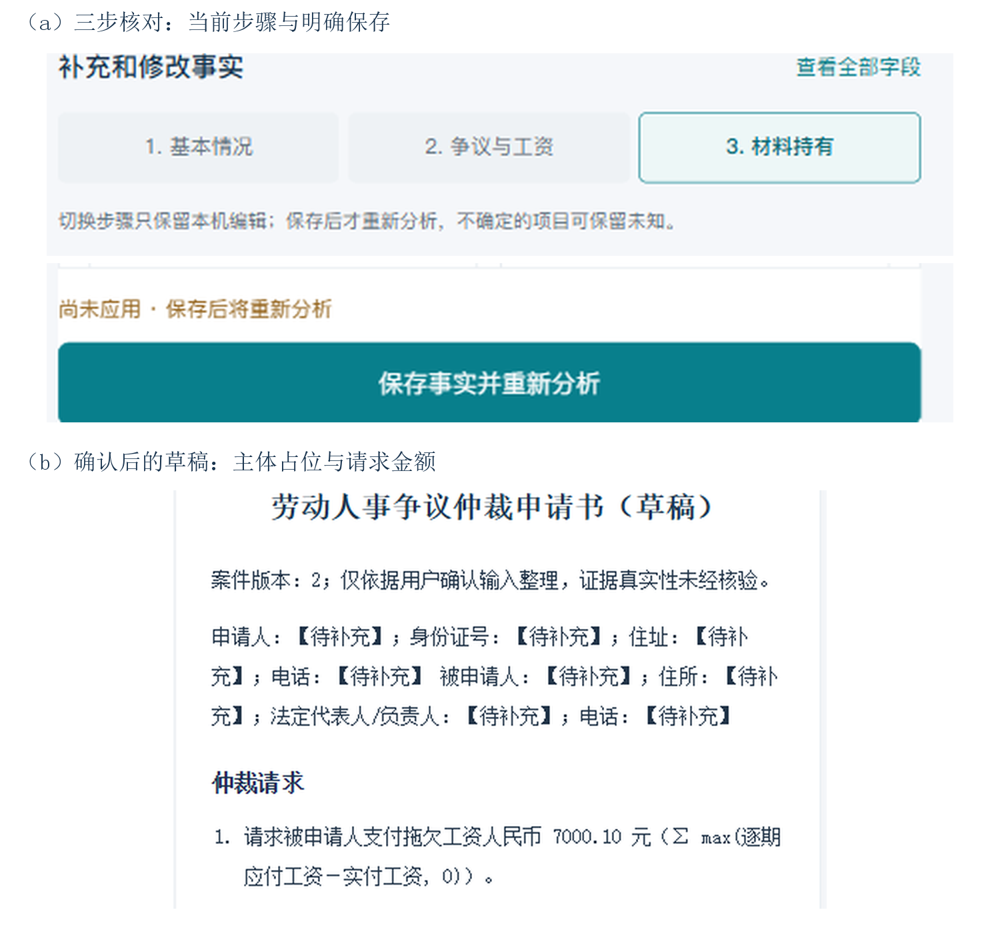
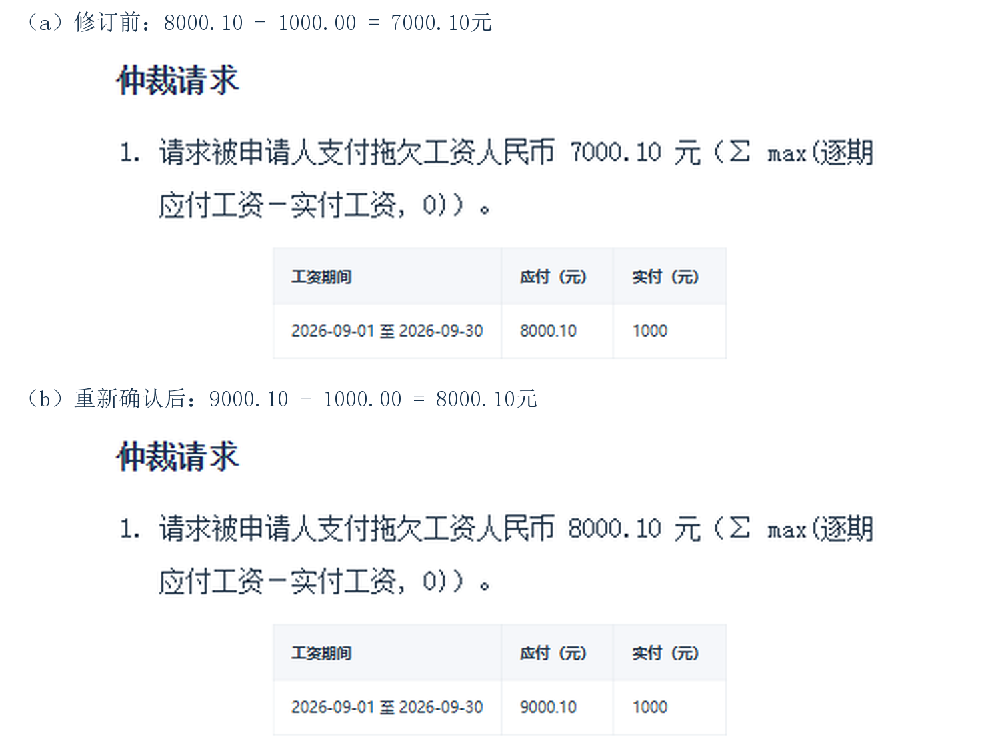

# 劳法智枢软件运行操作与测试说明

参赛配套附件

对应前端v18及现有案件工作流

劳法智枢项目组

2026年11月2日

## 1 阅读与运行准备

### 1.1 附件用途与软件版本

本附件帮助评审或演示人员定位源码、启动软件、执行代表任务并查看验证记录。研究与设计原理见《劳法智枢研究与开发报告（参赛版）》，原始文件位置见《参赛作品材料索引》。本附件整理现有运行入口和2026年10月28日等既有验证结果，本轮文档制作不新增模型调用。

当前前端为frontend-20261028-v18-dev，咨询和案件工作流分别为conversation-20261026-v16、casework-20261026-v16，计算规则为labor-scope-20261025-v3。v18截图对应当前界面；已保存录像分别标明早期规则演示和v17工程演示版本。

### 1.2 环境与源码组成

（1）运行环境。推荐使用Windows、Python 3.12、现代桌面浏览器和PowerShell。本机已有venv虚拟环境，可直接使用。Python依赖在requirements.txt中，本机精确版本记录在requirements-win-py312.snapshot.txt中，便于按已有环境复现。

（2）应用入口。start_server.py启动FastAPI服务；frontend保存页面；legal_ai_agent/api负责接口；legal_ai_agent/casework负责事实、法源、条件、计算、审查和图编排；tests和scripts保存回归与验证工具。

（3）知识与记录。data/legal_sources/manifest.json为法源构建入口，db保存运行索引和本机状态，docs/evaluation保存公开工程任务和真实模型实验记录。公开演示使用合成数据；私有会话、密钥及本机虚拟环境与公开源码分开管理。

## 2 安装配置与启动

### 2.1 使用现有环境

在项目根目录打开PowerShell。以下命令中的当前目录应是解压或检出的源码目录；本机项目位置为D:\BaiduNetdiskDownload\legal_ai_agent。

```powershell
.\venv\Scripts\python.exe --version
.\venv\Scripts\python.exe build_db.py --activate
$env:CASE_MODEL_ENABLED="0"
$env:LEGAL_VECTOR_SEARCH="0"
.\venv\Scripts\python.exe start_server.py
```

build_db.py从法源清单构建候选索引、执行内置验收并切换使用；服务默认端口为8000。浏览器打开http://localhost:8000，看到“法律咨询”和“案件工作区”入口即可开始操作。保持启动窗口运行，结束时在该窗口按Ctrl+C。

在全新环境中，先使用Python 3.12创建虚拟环境并安装依赖，再执行上述构建和启动步骤：

```powershell
python -m venv venv
.\venv\Scripts\python.exe -m pip install -r requirements.txt
```

### 2.2 规则演示与模型增强

规则演示适合展示欠薪期间核对、法源检索、确定性算术、确认、草稿和修订。本机进程设置CASE_MODEL_ENABLED=0后，案件流程使用规则路径。精确法条查询和简单寒暄也可直接运行。

自然法律解释按独立咨询路径调用模型，因此CASE_MODEL_ENABLED=0仅控制案件图的模型增强。无密钥演示时，以精确法条和案件规则流程为主；准备连续法律解释或真实角色分析时配置模型服务。

模型配置在项目根目录的本机.env中完成，示例如下。只填控制台提供且相互匹配的Key与兼容地址，工作空间专用Key使用对应Host。

```text
DASHSCOPE_API_KEY=<本机有效密钥>
DASHSCOPE_BASE_URL=<控制台提供的OpenAI兼容Base URL>
CASE_MODEL_ENABLED=1
```

如当前PowerShell已设置CASE_MODEL_ENABLED=0，启用前执行下列命令并重新启动，避免进程变量覆盖.env设置：

```powershell
$env:CASE_MODEL_ENABLED="1"
.\venv\Scripts\python.exe start_server.py
```

Judge与Doc默认使用Qwen-plus；需要独立配置Review模型时，按现有环境策略设置CASE_REVIEW_MODEL。真实模型调用产生服务用量，公开截图或文档只展示配置项，不展示实际密钥。

### 2.3 索引维护与常见启动问题

更新法源资料后，执行build_db.py构建验收；需要启用时使用--activate并重启服务。回退使用build_db.py --rollback，之后同样重启。现有默认路径使用词项检索；--embeddings --activate与LEGAL_VECTOR_SEARCH=1用于已配置模型服务的可选向量路径。

页面无法连接时，先查看启动窗口是否成功监听8000端口；端口被占用时关闭旧的本项目服务后重启。知识索引报错时检查法源清单及构建输出。模型401或403时核对Key、地域和工作空间地址；请求超时时查看页面本轮失败原因，已有有效案件保留，重试前先同步当前状态。

## 3 软件操作流程

### 3.1 自然咨询与查看依据

（1）新建对话，在“法律咨询”中输入“劳动合同法第47条是什么”。精确查询显示该法条原文及实际检索依据。

（2）点击引用或“查看本轮检索依据”，打开来源详情，核对法名、条款、地域、有效期间和官方链接。来源对应所属回答；点击返回位置可定位原消息。

（3）配置模型后可连续询问概念或追问“这条是什么意思”。相关历史承接当前问题；普通咨询保持聊天表达。指代不清时按照系统追问补充。

### 3.2 创建广州欠薪案件

新建对话，输入“我在广州工作，公司也在广州，请按我的情况整理欠薪材料，没有考勤，有工资流水”。进入案件核对后，按三步引导填写以下合成信息：

（1）基本情况：劳动合同履行地广州，用人单位所在地广州，争议日期2026年10月1日；其余事实按演示输入或保留未知。

（2）争议与工资：选择欠薪，增加工资期间2026年9月1日至30日，应付工资8000.10元，实付1000.00元。

（3）材料持有：工资流水为称持有，考勤为缺失。步骤切换只保留本地编辑；明确保存后才提交分析。

系统实际执行接待、检索、分析、计算与审查，阶段信息在页面可见。检查结果应为7000.10元，并显示所填工资期间和相应算式。实际字段展示以当前步骤及条件为准，可切换完整表单核对。



资料来源：v18实际页面，合成欠薪案件，规则路径。

### 3.3 确认并形成草稿

查看请求条件、算式和实际法源，处理页面列出的关键问题。选择拖欠工资请求，点击“核对事实、请求和金额，生成草稿”。系统接收当前版本确认后形成申请书草稿，并进行文书一致性检查。

检查请求金额7000.10元与期间明细相同，考勤没有被写为用户称持有材料。申请人、单位名称和地址等未填信息以占位提示。可以复制Markdown继续补充和专业复核，材料准备摘要列出请求、待补事项和下一步。

### 3.4 修订工资并再次确认

打开当前案件，将该期应付由8000.10元改为9000.10元，实付保持1000.00元。编辑后页面暂停旧稿使用；明确保存后后端更新案件版本，旧分析、金额、确认和草稿失效。

重新分析得到8000.10元。再次核对并确认后，新稿请求和工资明细对应8000.10元。该操作分别检验编辑保护、后端失效、金额重算和确认绑定，修订前后界面见附图2。



资料来源：v18实际草稿与修订截图，报告标注说明。

### 3.5 历史、同步与异常说明

（1）历史与会话。切换会话查看各自消息、案件和来源；返回原会话保留编辑及当前位置。历史案件结果只读，当前工作区展示最新状态。

（2）过期确认。旧版本操作返回409后，按提示同步最新案件，再核对确认。同步和重试不会自动替用户确认。

（3）解释与修订。询问“为什么需要工资流水”属于只读解释，当前案件版本保持；明确修改某期应付或实付才进入事实变更。工资用途不明时先澄清。

（4）资料与条件。地域或关键事实不清时补充信息；参数待核验时查看公式和缺项；跨境履行等复杂情形进入专业复核。系统根据事项返回明确的下一步。

（5）请求中断。网络失败或模型超时后查看已完成阶段，保留此前有效案件；重新进入或刷新后先同步，不复制待同步旧稿。

## 4 测试方案与既有结果

### 4.1 验证分层与结果口径

现有工程验证日期主要为2026年10月28日，来源为docs/evaluation/frontend_v18。Python回归146项、前端控制器13项、公开工程任务60案均通过；浏览器主流程32项和异常边界19项通过；1440、1024和390像素视口检查无页面横向溢出。

这些检查分别核对字段、算式、条件、状态和交互结果。专业法律评价将在独立评分协议下继续开展，使用与工程数据不同的指标。参与者首次使用、实体手机和独立盲测列入后续验证任务。

原始日志包含主动触发的409、503及网络失败，属于相应故障任务。浏览器记录保留一次预期409资源错误和一次主动注入的ERR_FAILED，未观察到其他JavaScript异常。进度验证仅延迟真实SSE事件的传输便于观察，没有替换执行事件。

### 4.2 代表性检查与证据位置

（1）欠薪正常与修订。输入8000.10/1000得到7000.10元；改为9000.10/1000得到8000.10元。确认和再确认后，草稿分别使用对应金额。证据为frontend_v18/browser-flow.json及同目录工程产物，具体截图见材料索引。

（2）否定与缺失。“没有考勤”保留缺失状态，未知和false分别处理；用户法律主张与事实区分。证据为Python回归和冻结工程集的否定缺失分组。

（3）法名与地域。《劳动法》第47条与《劳动合同法》第47条精确区分，城市及历史版本筛选先于内容排序。证据为冻结工程任务的地域版本分组和检索检查。

（4）版本409与失效。过期确认要求同步，保存修改撤销旧确认与草稿，未保存编辑暂停复制。证据为browser-failures.json、browser-edits.json及相关HTTP记录。

（5）来源与解释。历史来源绑定原回答，未引用来源不构造对应锚点，解释材料不更新案件版本。证据为browser-citations.json、browser-flow.json及live-explanation.json。

（6）响应式与键盘。三档视口、详情关闭、返回定位、焦点和剪贴板检查分别保存；真人和实体手机任务使用USABILITY_TEST.md继续记录。

### 4.3 三组真实模型实验

固定Qwen-plus实验每组60个任务，分为单Agent、协同无审查和协同有审查。三组形成产物各60份，成功调用分别60、120、180次，自动标记分别15、2、8份；已报告token分别791864、1588002、2402071，角色调用耗时中位数分别4.828、7.125、7.312秒。

原始文件model_ablation.json保存任务编号、组别、输出、自动检查、实际模型、usage及seconds。自动标记定义为结构、引用、金额、请求集合或门槛检查提示；耗时为单次角色调用。研究报告展示完整比较及经验分布曲线，后续专业评分据逐案产物开展。

现有生产路径另保存真实模型欠薪四阶段流程和十个扩展场景记录，其中九项满足严格工程预期，一项审查超时后停止出稿。与固定模型对照分别列示，便于按协议查看。

### 4.4 回归与复现命令

以下命令供后续复核时使用，本次文档整理未重新执行应用测试或模型实验。Python使用项目虚拟环境；前端控制器测试需要Node.js，应用日常运行无需Node构建。

```powershell
.\venv\Scripts\python.exe -m unittest discover -s tests -v
node --test tests/frontend_workspace.test.cjs
.\venv\Scripts\python.exe scripts/run_case_evaluation.py --engineering
```

真实模型实验和浏览器任务的运行说明见scripts/README.md。需要重新采集时使用新的输出目录，保留原结果；模型实验会产生实际调用，既有报告可直接用于本轮材料核验。

## 5 材料定位与后续验证

### 5.1 交付物与原始记录

（1）作品研究：《劳法智枢研究与开发报告（参赛版）》及其可编辑正文，包含七幅图、四张表和三个技术公式。

（2）应用源码：frontend、legal_ai_agent、data/legal_sources、tests和scripts，以及根目录README、requirements、start_server.py和build_db.py。实际源码保留于项目，本轮不另生成压缩包。

（3）工程记录：docs/evaluation/frontend_v18/validation.json及其日志、工程与浏览器文件；真实模型记录位于docs/evaluation/casework_v2。详见《参赛作品材料索引》，该索引逐项标注用途和版本。

（4）演示素材：v18界面截图，以及2026年10月25日规则演示录像和v17工程录像。录像版本与截图分别标注，书面评审以当前报告和v18截图说明为主。

### 5.2 后续验证安排

后续先完善广深补偿参数，再组织教师或律师逐案评价；邀请六位非计算机专业同学执行提问、查来源、进入案件、修订工资和复制草稿，记录首次成功及误解；开展实体手机软键盘与缩放测试，并以独立案例持续检验条件、来源和材料一致性。

对外试用阶段进一步完善授权告知、数据留存删除、访问控制与事务存储。运行和专业使用定位、参数进度及验证计划在本附件集中说明，评审可据索引查看已形成成果与后续研发路径。
